# dsh-calendar-pro User Manual

> **Language**: English (this page) · [中文](MANUAL.md)
>
> See also: [README](README.en.md) · [Changelog](CHANGELOG.en.md)
>
> Screenshots show the Chinese interface; the layout is identical in English.

Most things in your calendar can be done by simply telling DSH what you want — checking your schedule, booking a meeting, moving an appointment, finding a free slot. The agent takes care of it.

## Contents

- [dsh-calendar-pro User Manual](#dsh-calendar-pro-user-manual)
  - [Contents](#contents)
  - [1. Manage Your Schedule with the Agent](#1-manage-your-schedule-with-the-agent)
  - [2. First Launch: Where Your Events Live](#2-first-launch-where-your-events-live)
  - [3. Connect a Calendar for Your Other Devices](#3-connect-a-calendar-for-your-other-devices)
    - [3.1 General Steps](#31-general-steps)
    - [3.2 iCloud](#32-icloud)
    - [3.3 Google](#33-google)
    - [3.4 Nextcloud](#34-nextcloud)
    - [3.5 Self-hosted or Other Calendar Services](#35-self-hosted-or-other-calendar-services)
    - [3.6 Switch Data Source](#36-switch-data-source)
    - [3.7 Connection Troubleshooting](#37-connection-troubleshooting)
  - [4. Interface Overview](#4-interface-overview)
    - [4.1 Sidebar Calendar](#41-sidebar-calendar)
    - [4.2 Top Action Bar](#42-top-action-bar)
    - [4.3 Floating Button](#43-floating-button)
    - [4.4 Settings Page](#44-settings-page)
  - [5. Managing Events Manually](#5-managing-events-manually)
    - [5.1 Viewing Events](#51-viewing-events)
    - [5.2 Creating an Event](#52-creating-an-event)
    - [5.3 Editing an Event](#53-editing-an-event)
    - [5.4 Deleting an Event](#54-deleting-an-event)
    - [5.5 Finding Available Time](#55-finding-available-time)
  - [6. Cycle Tracking](#6-cycle-tracking)
  - [7. ICS Import and Export](#7-ics-import-and-export)
    - [7.1 Import](#71-import)
    - [7.2 Export](#72-export)
  - [8. Lunar Calendar and Public Holidays](#8-lunar-calendar-and-public-holidays)
  - [9. Interface Language](#9-interface-language)
  - [10. FAQ](#10-faq)

---

## 1. Manage Your Schedule with the Agent

This is the easiest way: you don't even need to open the calendar.

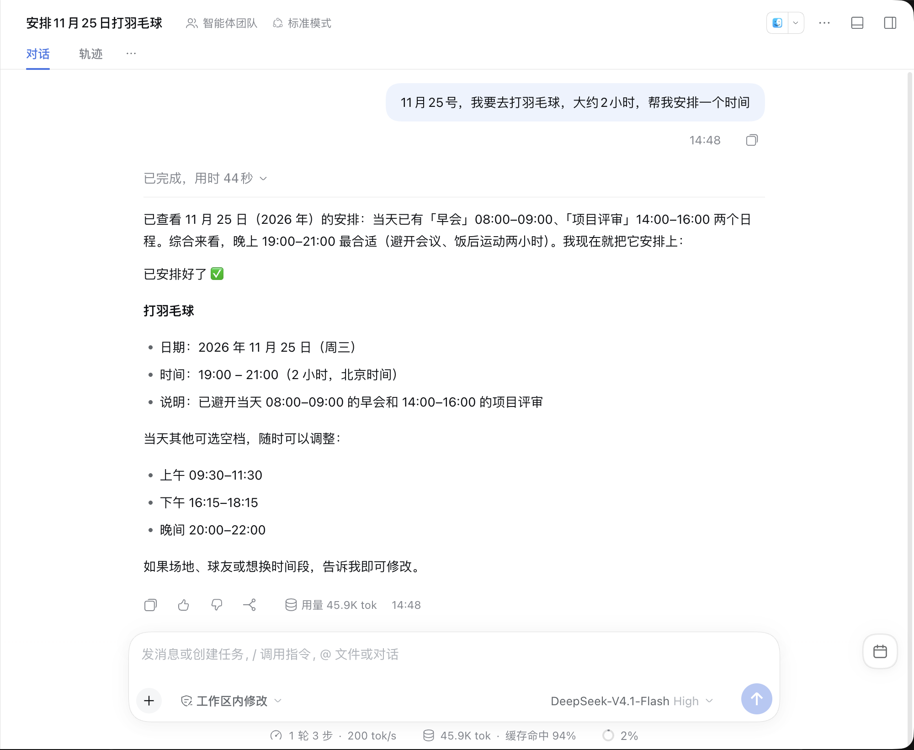

| What you want | Say something like |
| --- | --- |
| Check your schedule | "What's on next Wednesday?" / "How many meetings this week?" |
| Create an event | "Half-hour meeting with Alex next Thursday at 3 pm, title 'Scope review'" |
| Edit an event | "Move that meeting to Friday at 10 am" |
| Delete an event | "Delete the dentist reminder on Friday afternoon" |
| Find a time | "Find a two-hour slot next week for a retrospective" |
| Search events | "Which day last month was the hospital appointment?" |
| Connect a calendar | "Connect my iCloud calendar for me" |
| Tidy up events | "Move my local events over to iCloud" |

The agent looks up the event first, then edits or deletes it as you asked; if anything is unclear it will check with you first. Deletions cannot be undone, so export a backup of important events from time to time.

> You only need to provide your account and app-specific password once, when connecting a calendar. After that, day-to-day use rarely requires opening Settings.

## 2. First Launch: Where Your Events Live

The first time you open the calendar you'll see "Get started", asking where your events should be stored:

| Option | Best for | What it means |
| --- | --- | --- |
| **Use local calendar** | You don't want to deal with accounts, or only schedule inside DSH | Stored on this machine, no account needed, works immediately |
| **Connect a remote calendar** | You already use iCloud, Google or Nextcloud | Opens the connection form; once filled in, events sync to your phone and other devices |

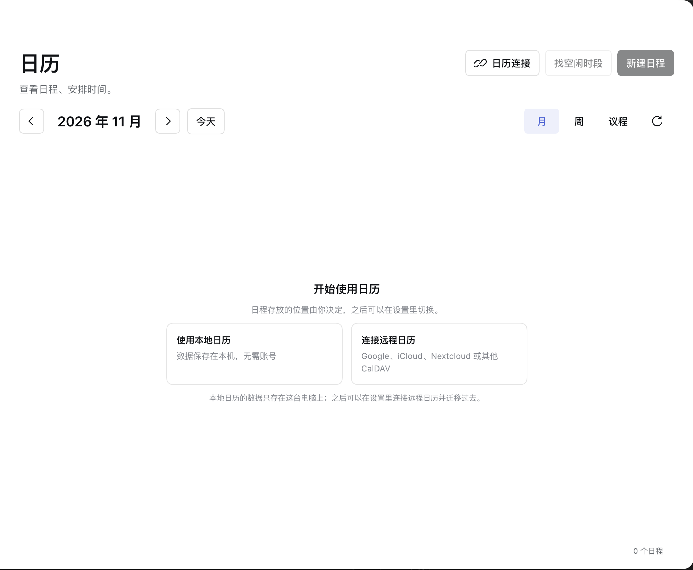

You can change this any time under **Settings → Calendar → Calendar source**. Switching copies your existing events across (see [3.6](#36-switch-data-source)).

## 3. Connect a Calendar for Your Other Devices

Once connected, changes made in DSH appear on your other devices, and changes made there come back here.

### 3.1 General Steps

1. In the sidebar calendar, click **Calendar connection** in the top-right corner.
2. Choose a **provider** (Google / iCloud / Nextcloud / Custom).
3. Fill in the fields for that provider (see the sections below).

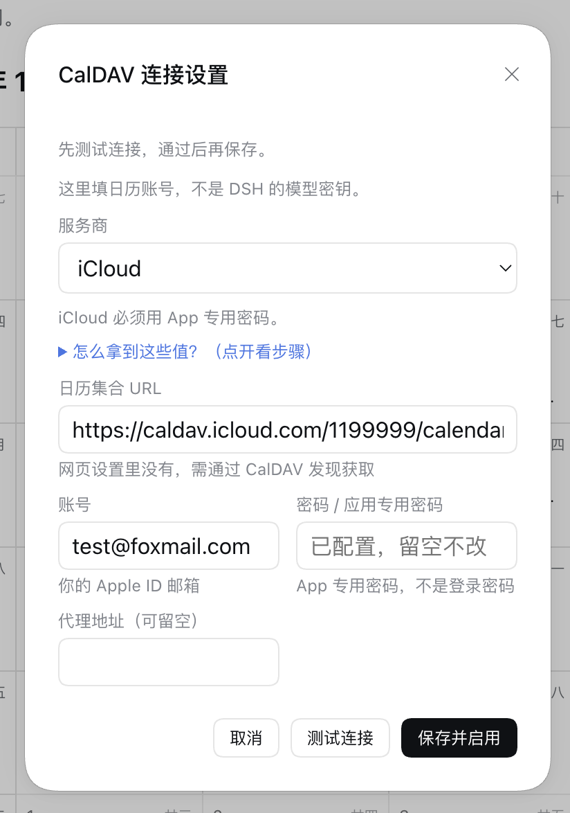

4. Click **Test connection** — this only reads data and never changes any event.
5. Once it succeeds, click **Save and enable**. You'll see "Connected: found N events in the next 30 days", and the calendar switches over immediately.

Connection details are stored on this computer and take effect right away; no restart needed.

### 3.2 iCloud

| Field | What to enter |
| --- | --- |
| Calendar collection URL | Filled in by **Find my calendars** — no need to copy it by hand |
| Account | Your Apple ID email address |
| Password | An **app-specific password**, not your Apple ID password |

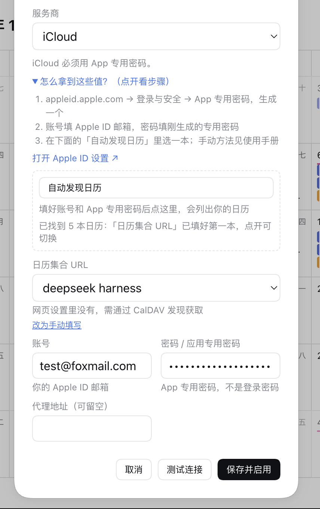

Three steps:

1. Go to [appleid.apple.com](https://appleid.apple.com) → **Sign-In and Security** → **App-Specific Passwords** and generate one (format `xxxx-xxxx-xxxx-xxxx`).
2. In the connection form, fill in **Account** (your Apple ID email) and **Password** (the password from step 1).
3. Expand "**Where do these values come from?**" and click "**Find my calendars**":

   - One click lists all calendars under that account
   - **Calendar collection URL** becomes a **dropdown**, with the first calendar selected; open it to pick another, or click **Enter URL manually** to type one
   - Then continue with **Test connection → Save and enable**

> The iCloud website does not show this address, which is why automatic discovery is the easiest route. If discovery fails, check your network or enter a **Proxy URL** in the form and try again.
> An app-specific password is required by Apple; your regular Apple ID password will not work. You can revoke app-specific passwords at appleid.apple.com at any time.

### 3.3 Google

Google does not accept app-specific passwords; OAuth is required.

| Field | What to enter |
| --- | --- |
| Calendar collection URL | Usually no change needed |
| Account | Your Gmail address |
| Password | Leave empty (not used with OAuth) |
| clientId / clientSecret | OAuth client credentials; choose "Desktop app" as the type |
| refreshToken | Obtained once through authorization; valid long-term |
| Token URL | Leave empty to use Google's official endpoint |

Four steps:

1. In the [Google Cloud console](https://console.cloud.google.com), create a project and enable the **Google Calendar API**.
2. Go to **Credentials → Create credentials → OAuth client ID**, choose **Desktop app**, and copy the clientId and clientSecret.
3. Open [OAuth Playground](https://developers.google.com/oauthplayground): in the gear menu tick **Use your own OAuth credentials**, enter the clientId / clientSecret from step 2, authorize the scope `https://www.googleapis.com/auth/calendar`, and exchange a refreshToken.
4. The calendar ID is usually your Gmail address. Fill everything in and click **Test connection**.

> "Where do these values come from?" in the form contains these same steps, so you can expand it whenever you forget.

### 3.4 Nextcloud

| Field | What to enter |
| --- | --- |
| Server | Include `https://`, with no trailing `/` |
| User | The username used to build the CalDAV address (usually your login name) |
| Calendar name | The default personal calendar is `personal` |
| Account / Password | Credentials for authentication; an app password or your login password both work |

### 3.5 Self-hosted or Other Calendar Services

Choose **Custom** as the provider and enter the full calendar collection URL — **keep the trailing `/`**:

```
https://cloud.example.com/remote.php/dav/calendars/username/calendarname/
```

Then fill in your account and password. Any CalDAV-compatible service can be connected this way.

### 3.6 Switch Data Source

Under **Settings → Calendar → Calendar source** you can see which source is active and switch with one click:

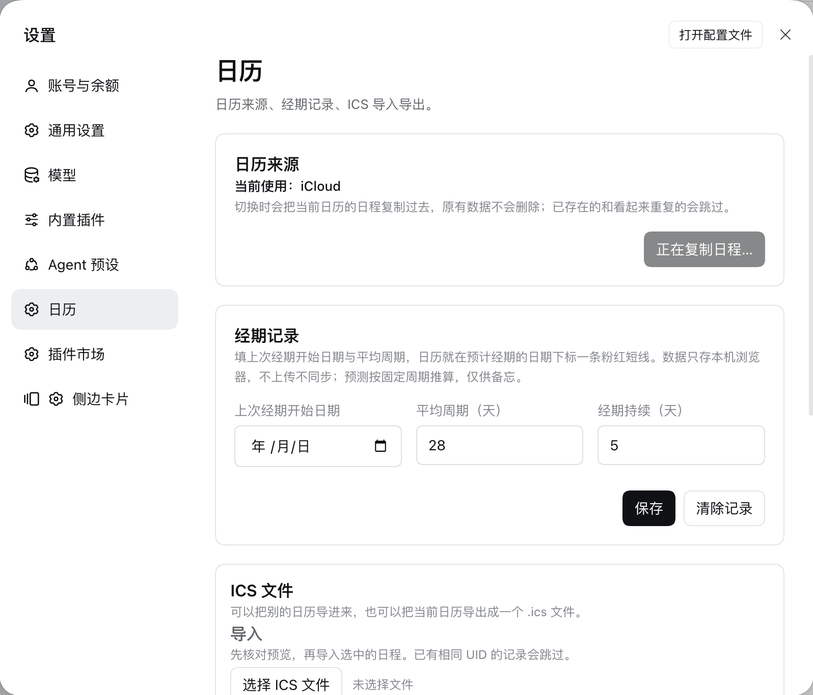

- Switching to a remote calendar requires a successful connection first
- Switching **copies** your current events to the target; nothing is deleted
- Events that already exist are skipped, so nothing is duplicated

This is a one-time transfer, **not continuous two-way sync**. If you need both, pick one as your main calendar and transfer again when needed.

### 3.7 Connection Troubleshooting

| Symptom | Usual cause |
| --- | --- |
| Authentication fails | iCloud: you used your login password instead of an app-specific password; Google: you used a password instead of OAuth |
| Calendar not found | The collection URL is missing its trailing `/`, or the calendar name is wrong |
| Connection times out | Your network needs a proxy — fill in **Proxy URL** |
| Test succeeds but no events appear | Go back to **Calendar connection** and save again |

You can also ask the agent to run a self-check; it will report whether the provider, address or credentials are at fault.

## 4. Interface Overview

### 4.1 Sidebar Calendar

"Calendar" in the left sidebar is the main view: an action bar plus the calendar area.

### 4.2 Top Action Bar

The sidebar calendar has three groups of controls:

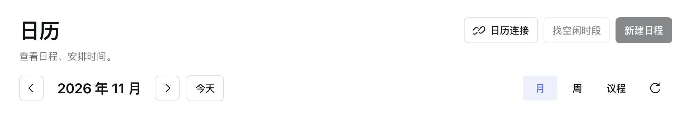

| Control | Where | What it does |
| --- | --- | --- |
| **Calendar connection** | Top right | Opens the connection form |
| **Find available time** | Top right | Opens the free-slot panel (unavailable until a remote calendar is connected) |
| **New event** | Top right | Opens the new-event form |
| ‹ date › Today | Second row, left | Previous period / back to today / next period |
| Month / Week / Agenda | Second row, right | Switches views; your choice is remembered |
| Refresh | Second row, right | Reloads the current time window |

### 4.3 Floating Button

The calendar icon in the bottom-right corner of a conversation opens the calendar in a floating panel **without interrupting your chat**; press `Esc` to close it. The button hides itself while you're already in the calendar panel.

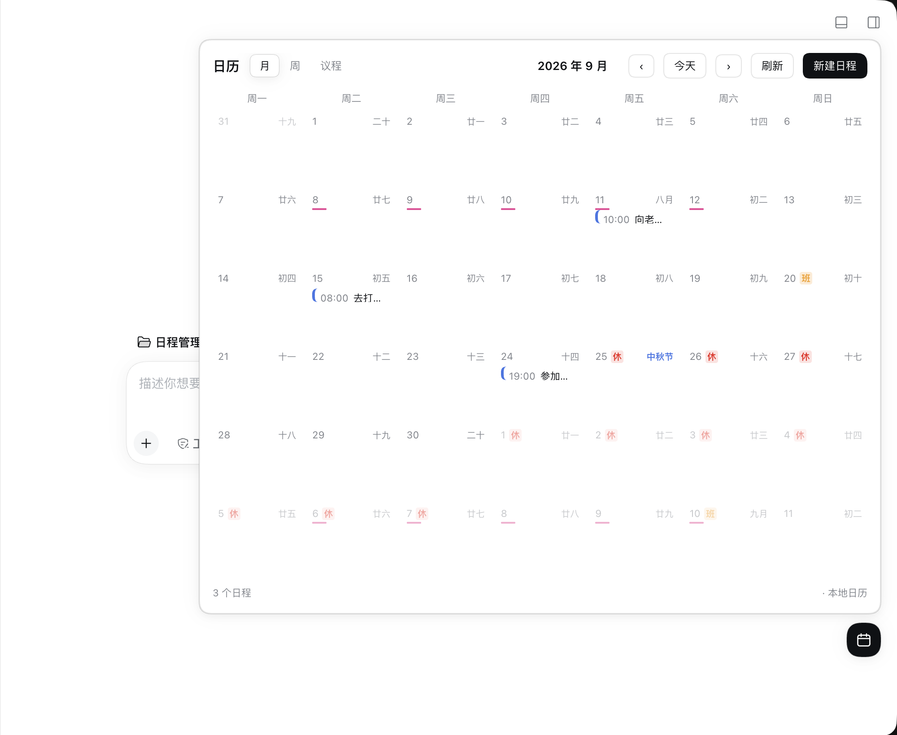

The floating panel is for a **quick look**: switch month / week / agenda, move between dates, glance at your day, or create an event. Connecting calendars and finding available time are done in the sidebar.

### 4.4 Settings Page

**DSH Settings → Calendar** has three sections: **Calendar source**, **Cycle tracking**, and **ICS import and export**.

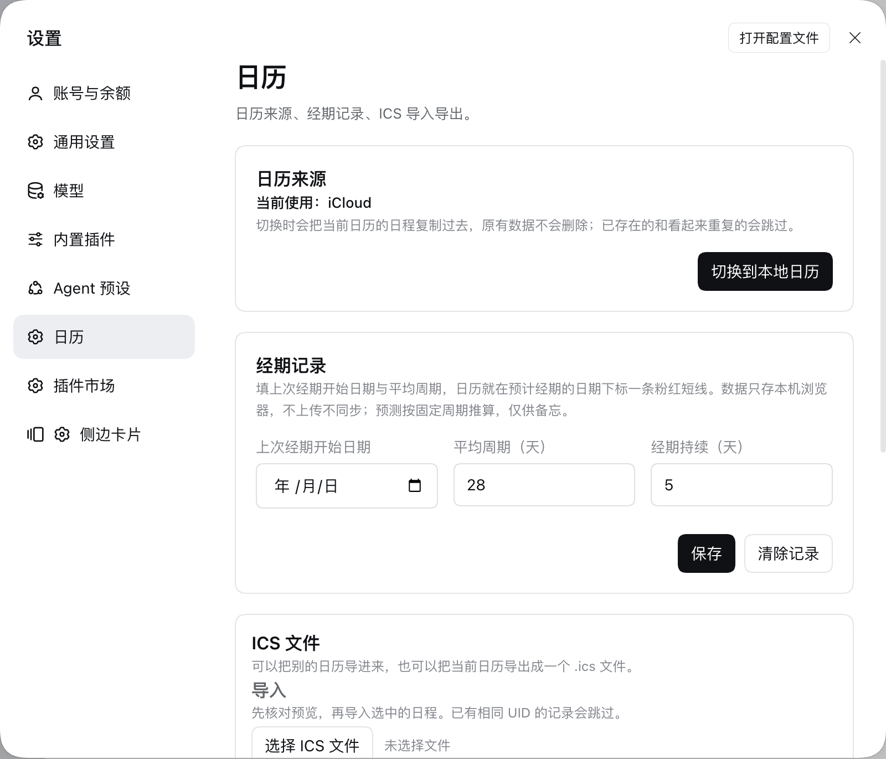

## 5. Managing Events Manually

Everything in this chapter can also be delegated to the agent (see [Chapter 1](#1-manage-your-schedule-with-the-agent)).

### 5.1 Viewing Events

Each view has its own purpose:

| View | Best for |
| --- | --- |
| Month | The whole month at a glance; predicted period days are marked with a short pink line |
| Week | How a day is laid out hour by hour; drag to reschedule |
| Agenda | A list of what's coming up, easy to scan |

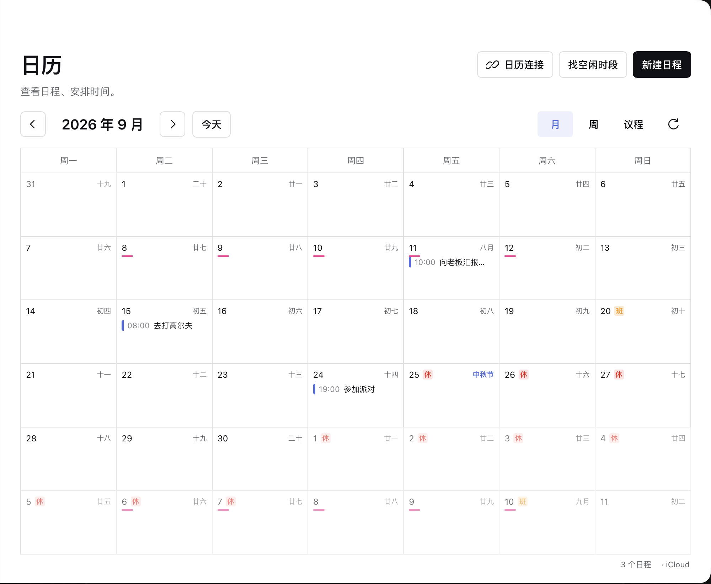

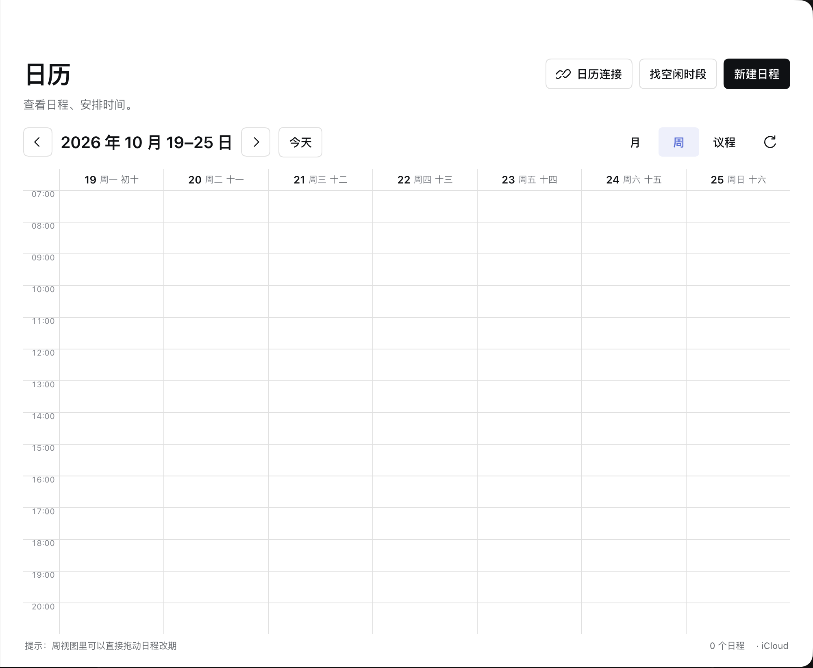

### 5.2 Creating an Event

Two ways:

1. Click **New event** in the action bar and fill in the form.
2. Click a day directly in the calendar (in Week view you can click a specific time slot) — the form opens with that time filled in.

Form fields:

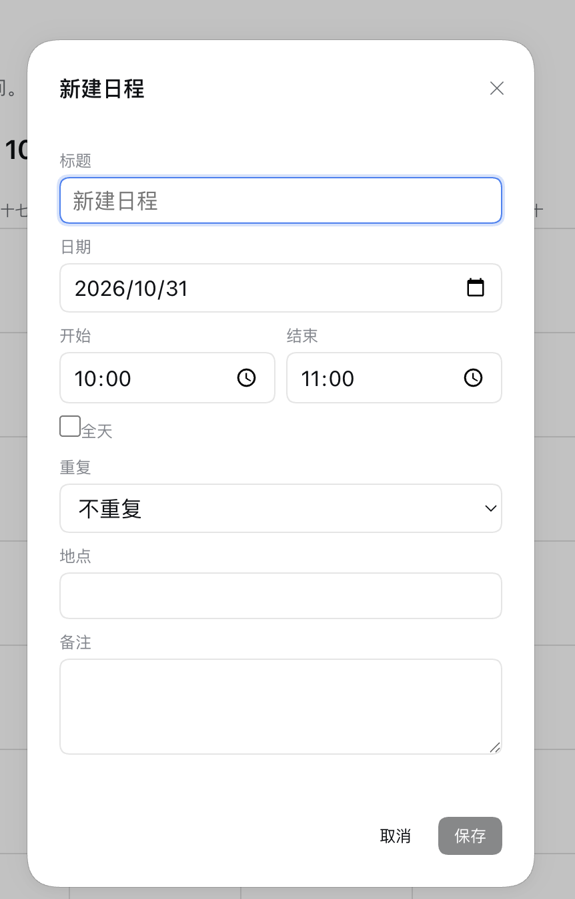

| Field | Description |
| --- | --- |
| Title | Required; cannot be saved empty |
| Date | The day of the event |
| Start / End | Clock times; with "All day" checked, only the date is kept |
| All day | Turns the event into an all-day event |
| Repeat | Never / Daily / Weekly / Monthly / Yearly / custom rule |
| Location, Notes | Optional |

If the time overlaps other events, the form shows "First occurrence overlaps N events" — you can still save.

### 5.3 Editing an Event

Click an event → open its details → **Edit** → save.

**Drag to reschedule** works only in **Week view**: drag the event to a new time and release. An undo bar appears at the top; click **Undo** to revert.

> Editing a recurring event affects the **whole series**, and the form says so. If any occurrence has already been moved or cancelled individually, you can no longer change the start time, all-day setting or recurrence rule for the series as a whole — do that in your original calendar app instead.

### 5.4 Deleting an Event

Open the details → **Delete** → confirm. Deletions cannot be undone.

Deleting a recurring event also removes the whole series; the confirmation dialog tells you how many occurrences will go.

### 5.5 Finding Available Time

Click **Find available time** in the action bar; the panel replaces the calendar view and disappears when closed:

| Parameter | Default |
| --- | --- |
| Start / end date | A period starting today; the end date is inclusive |
| Duration | 60 minutes (adjustable 5–480) |
| Work start / end | 09:00–18:00 |
| Buffer around timed events | 0 minutes (adjustable 0–120) |
| Workdays | Monday to Friday |

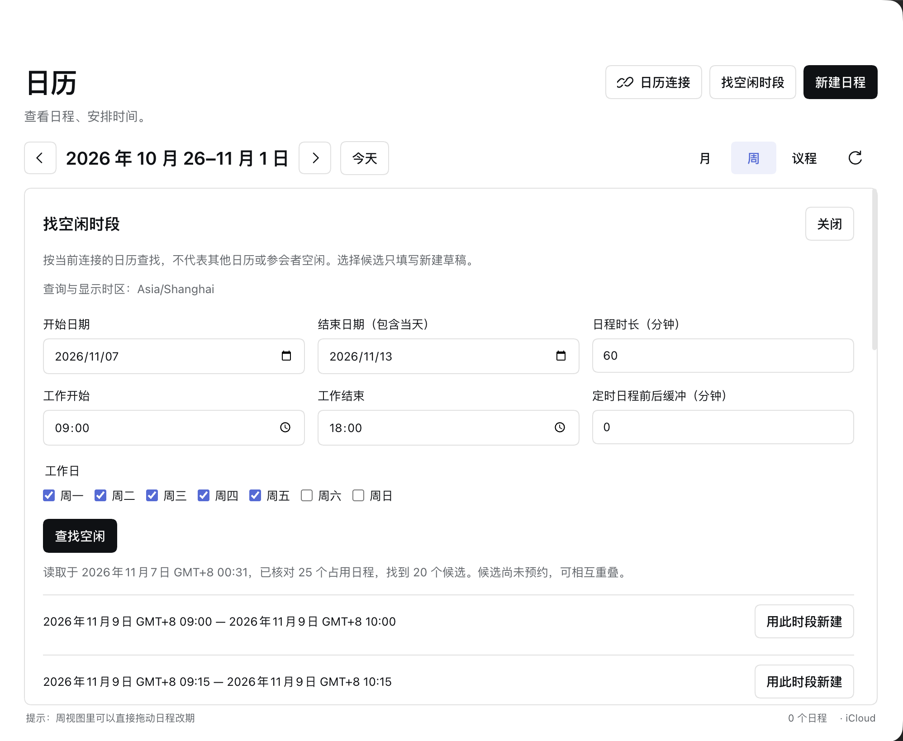

After clicking **Find slots**:

- Results are sorted by time, showing **at most the earliest 20 candidates**; candidates may overlap
- Click **Create with this slot** on a candidate to open a **draft** with that time filled in — nothing is created yet
- Only the **currently connected calendar** is queried; it says nothing about other calendars or attendees

## 6. Cycle Tracking

Under **Settings → Calendar → Cycle tracking**, fill in three fields:

| Field | Description |
| --- | --- |
| Last period start | The first day of your most recent period |
| Average cycle | Days between periods, commonly 28 |
| Period length | How many days it usually lasts |

Once saved, **Month view** marks predicted period days with a short pink line under the date; hover over that cell to see "Predicted period day N". With "Period length" set, consecutive days are marked too.

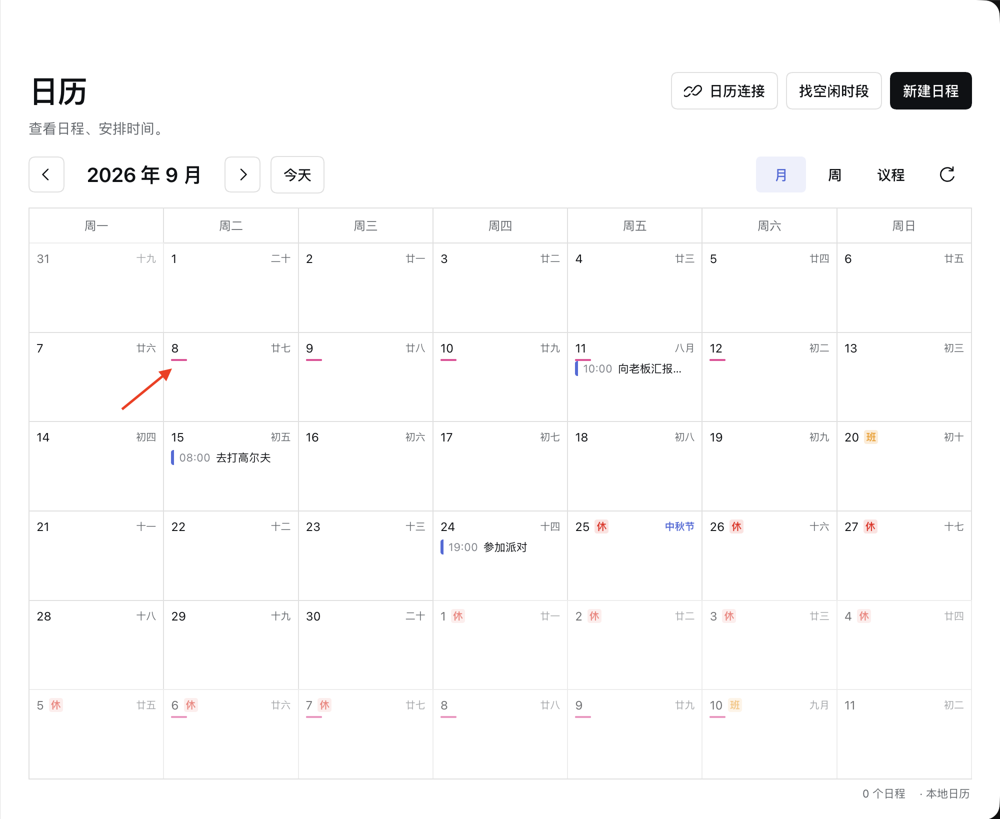

The record stays on this computer only — it is not synced to other devices or written to any calendar server — and cannot be recovered after being cleared.

> Predictions assume a fixed cycle, so irregular months may be off. Treat it as a reminder, not medical advice.

## 7. ICS Import and Export

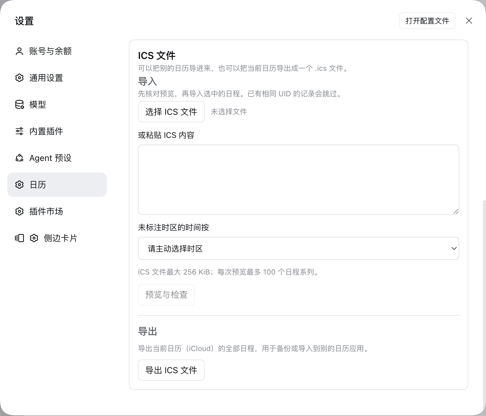

### 7.1 Import

Go to **Settings → Calendar → Import events from an ICS file**:

1. Choose an `.ics` file, or paste ICS content directly.
2. If the file's times have no timezone, choose one to interpret them (commonly `Asia/Shanghai`). Events that already have a timezone are unaffected.
3. Click **Preview and check**. This step only reads; nothing is written.
4. Review titles, times, recurrence exceptions, events that already exist, and first-occurrence overlap warnings.
5. Select the events to import (or click **Select next batch**), then **Confirm import**.

Limits:

| Item | Limit |
| --- | --- |
| Single file | 256 KiB max |
| Per preview | 100 event series max (1,000 events including exceptions) |
| Per batch | 20 series max |
| Preview validity | 15 minutes |
| Events that already exist | Skipped, never overwritten |

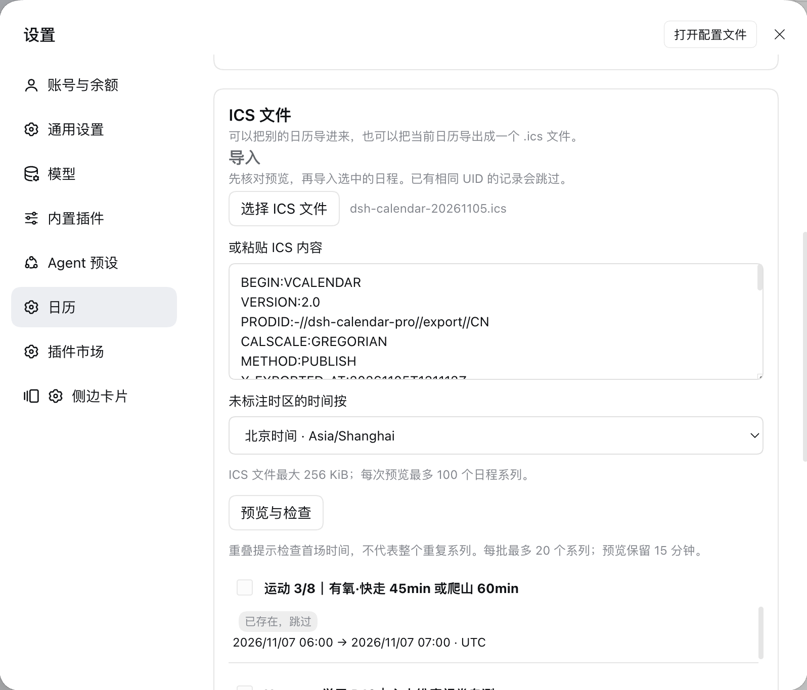

Failed items keep a retry button; **retry only processes the failures**, so successful imports are not written twice.

### 7.2 Export

Under **Settings → Calendar → Export**, click **Export ICS file** to download every event in the current calendar (local or remote) for backup or for moving to another calendar app.

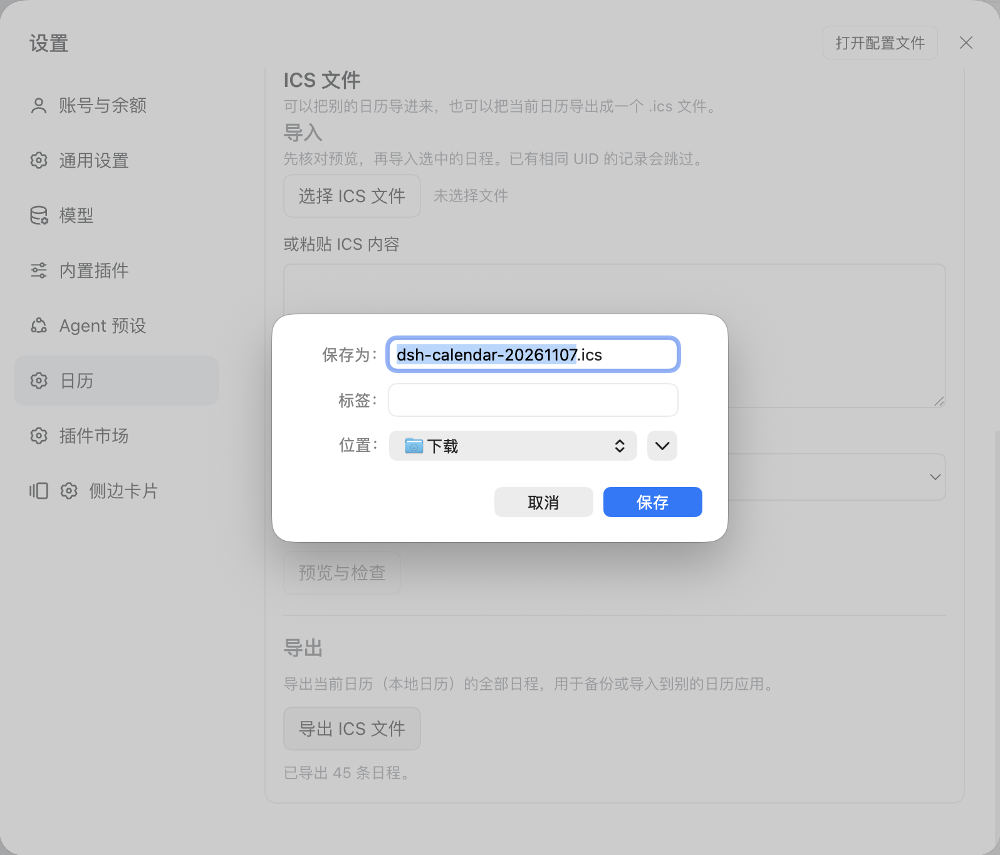

## 8. Lunar Calendar and Public Holidays

Date cells in Month and Week view show the lunar date. Public holidays and make-up workdays are marked with **Holiday** / **Workday** badges, so you don't have to look them up when scheduling.

Holiday data comes from the annual government notice and only covers published years. If a year is missing, update the plugin after the notice is released.

## 9. Interface Language

The interface **follows the DSH language setting** (DSH Settings → General → Language); the plugin has no separate switch. Switching to English changes UI text, date formats and recurrence descriptions together.

Event titles, locations and notes are your own data and are always displayed as written, never translated.

## 10. FAQ

**Q: After installing, the sidebar is empty and only shows "Get started".**
On first use, choose where events should be stored. Click "Use local calendar" to begin.

**Q: Where is my local calendar data? Can I back it up?**
It's at `$DSH_HOME/data/dsh-calendar-pro/calendar.json` (`DSH_HOME` defaults to `~/.dsh`). You can also export an ICS backup from Settings.

**Q: Does the local calendar sync to my phone?**
No. It exists only on this computer. To sync, connect iCloud, Google or Nextcloud, then switch over in "Calendar source"; existing events will be copied across.

**Q: I'm switching computers — how do I take my events with me?**
Export an ICS on the old machine, install the plugin on the new one and import it; or use a remote calendar, where the data lives on the server.

**Q: The agent says it can't find an event.**
Check the time range it searched. By default it looks at the next 7 days; be more specific, e.g. "search last month".

**Q: Why doesn't dragging to reschedule work?**
Dragging only works in **Week view**. In Month and Agenda views, open the event to change its time.

**Q: Can I use a local calendar and a remote calendar at the same time?**
Only one data source is active at a time. Switching copies events across, so nothing is lost.

**Q: Can I recover a deleted event?**
No. Deletions cannot be undone; export an ICS backup of important events regularly.
