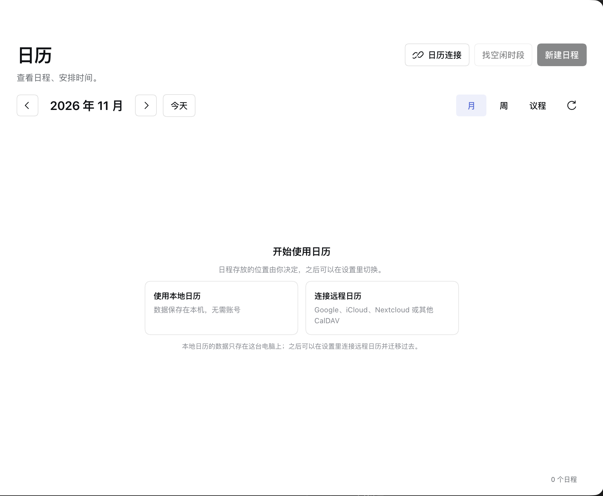
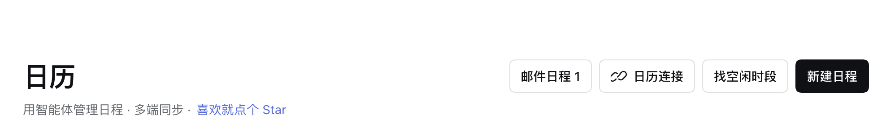
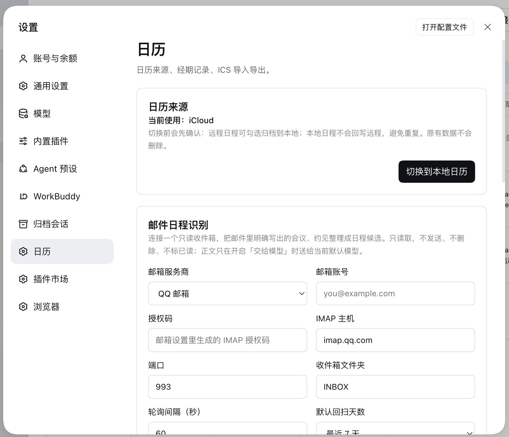
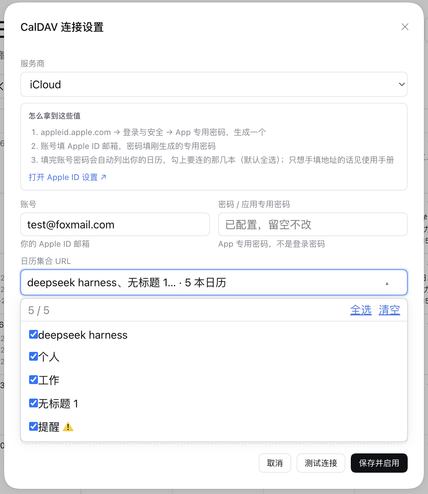

# dsh-calendar-pro User Manual

> **Language**: English (this page) · [中文](MANUAL.md)
>
> See also: [README](README.en.md) · [Changelog](CHANGELOG.en.md)

Everything in the calendar can be done by telling DSH in one sentence — checking the schedule, arranging meetings, moving times, finding a free slot. The agent handles it.

## Contents

- [dsh-calendar-pro User Manual](#dsh-calendar-pro-user-manual)
  - [Contents](#contents)
  - [1. Manage Your Schedule with the Agent](#1-manage-your-schedule-with-the-agent)
  - [2. First Launch: Choosing Where Events Are Stored](#2-first-launch-choosing-where-events-are-stored)
  - [3. Interface Overview](#3-interface-overview)
    - [3.1 Sidebar Calendar](#31-sidebar-calendar)
    - [3.2 Top Action Bar](#32-top-action-bar)
    - [3.3 Floating Button](#33-floating-button)
    - [3.4 Lunar Calendar and Public Holidays](#34-lunar-calendar-and-public-holidays)
    - [3.5 Settings Page](#35-settings-page)
    - [3.6 Interface Language](#36-interface-language)
  - [4. Connecting a Remote Calendar](#4-connecting-a-remote-calendar)
    - [4.1 Connection Procedure](#41-connection-procedure)
    - [4.2 iCloud](#42-icloud)
    - [4.3 Google](#43-google)
    - [4.4 Nextcloud](#44-nextcloud)
    - [4.5 Self-hosted or Other CalDAV Services](#45-self-hosted-or-other-caldav-services)
    - [4.6 Multiple Calendars](#46-multiple-calendars)
    - [4.7 Switching the Data Source](#47-switching-the-data-source)
    - [4.8 Connection Troubleshooting](#48-connection-troubleshooting)
  - [5. Managing Events Manually](#5-managing-events-manually)
    - [5.1 Viewing Events](#51-viewing-events)
    - [5.2 Creating an Event](#52-creating-an-event)
    - [5.3 Editing an Event](#53-editing-an-event)
    - [5.4 Deleting an Event](#54-deleting-an-event)
    - [5.5 Finding Available Time](#55-finding-available-time)
  - [6. Cycle Tracking](#6-cycle-tracking)
  - [7. ICS Import and Export](#7-ics-import-and-export)
    - [7.1 Import](#71-import)
    - [7.2 Export](#72-export)
  - [8. Schedules from Email](#8-schedules-from-email)
    - [8.1 Connect a Mailbox](#81-connect-a-mailbox)
    - [8.2 First Scan](#82-first-scan)
    - [8.3 Review List](#83-review-list)
    - [8.4 New Mail](#84-new-mail)
    - [8.5 Detection Scope](#85-detection-scope)
  - [9. FAQ](#9-faq)

---

## 1. Manage Your Schedule with the Agent

The most efficient approach: without opening the calendar, a single sentence states the request.


| What you want | Say something like |
| --- | --- |
| Check your schedule | "What's on next Wednesday?" / "How many meetings this week?" |
| Create an event | "Half-hour meeting with Alex next Thursday at 3 pm, title 'Scope review'" |
| Edit an event | "Move that meeting to Friday at 10 am" |
| Delete an event | "Delete the dentist reminder on Friday afternoon" |
| Find a time | "Find a two-hour slot next week for a retrospective" |
| Search events | "Which day last month was the hospital appointment?" |
| Connect a calendar | "Connect my iCloud calendar" |
| Transfer events | "Move my local events to iCloud" |

The agent locates the target event first, then edits or deletes it as instructed; if information is insufficient it asks for confirmation. Deletions are irreversible, so export a backup of important events periodically.

> The account and app-specific password are required only when connecting a calendar. Afterwards, day-to-day use rarely requires opening Settings.

**Connecting a calendar and importing/exporting, covered in later chapters, can also be delegated to the agent.**

## 2. First Launch: Choosing Where Events Are Stored

On first launch, the "Get started" screen asks where events should be stored:

| Option | Best for | What it means |
| --- | --- | --- |
| **Use local calendar** | No account required, or scheduling only inside DSH | Stored on this machine; works immediately |
| **Connect a remote calendar** | Already using iCloud, Google or Nextcloud | Opens the connection form (see [Chapter 4](#4-connecting-a-remote-calendar)); events then sync to the phone and other devices |



This can be changed at any time under **Settings → Calendar → Calendar source** (see [4.7](#47-switching-the-data-source)).

## 3. Interface Overview

### 3.1 Sidebar Calendar

"Calendar" in the left sidebar is the main view: an action bar plus the calendar area.

### 3.2 Top Action Bar

Four action buttons sit at the top right of the page header:



| Button | What it does | See |
| --- | --- | --- |
| **Mail schedules** | Opens the review list; shows a count while something is pending | [Chapter 8](#8-schedules-from-email) |
| **Calendar connection** | Opens the connection form | [Chapter 4](#4-connecting-a-remote-calendar) |
| **Find available time** | Opens the free-slot dialog with the calendar behind it (unavailable until a remote calendar is connected) | [5.5](#55-finding-available-time) |
| **New event** | Opens the new-event form | [5.2](#52-creating-an-event) |

A second row above the calendar grid holds the view controls:

| Control | Where | What it does |
| --- | --- | --- |
| ‹ date › Today | Left | Previous period / back to today / next period |
| Month / Week / Agenda | Right | Switches views; the choice is remembered |
| Refresh | Right | Reloads the current time window |

### 3.3 Floating Button

The calendar icon at the bottom right of a conversation opens the calendar in a floating panel **without interrupting the conversation**; press `Esc` to close it. The button is hidden while the calendar panel is open.


The floating panel carries only paging, month / week / agenda, refresh and **New event**. Mail schedules, calendar connection and available-time search are provided in the sidebar only, so no feature has two entry points.

### 3.4 Lunar Calendar and Public Holidays

Date cells in Month and Week view show the lunar date. Public holidays and make-up workdays are marked with **Holiday** / **Workday** badges, so no separate lookup is needed when scheduling.

Holiday data comes from the annual government notice and covers published years only. If a year is missing, update the plugin once the notice is released.

### 3.5 Settings Page

**DSH Settings → Calendar** has four sections:

| Section | Purpose | See |
| --- | --- | --- |
| **Calendar source** | Shows the active source; switches between local and remote | [4.7](#47-switching-the-data-source) |
| **Mail schedule detection** | Connects a read-only inbox and extracts schedule candidates from mail | [Chapter 8](#8-schedules-from-email) |
| **Cycle tracking** | Records period dates and marks predictions in Month view | [Chapter 6](#6-cycle-tracking) |
| **ICS import and export** | Imports and exports `.ics` files | [Chapter 7](#7-ics-import-and-export) |



### 3.6 Interface Language

The interface **follows the DSH language setting** (DSH Settings → General → Language); the plugin has no separate switch. Switching to English changes UI text, date formats and recurrence descriptions together.

Event titles, locations and notes are personal data, always displayed as written and never translated.

## 4. Connecting a Remote Calendar

Once connected, DSH stays in sync with the calendar server: events changed in DSH are written to the server, and the phone and other devices pick them up through the same account.

### 4.1 Connection Procedure

The steps are the same for every provider; only the credential type and automatic discovery differ:

1. **Open the form**: in the sidebar calendar, click **Calendar connection** at the top right.
2. **Choose the provider**: iCloud is the default; switch manually for Google, Nextcloud or custom CalDAV. The fields change with the provider, and the steps and links for obtaining its values remain visible underneath.
3. **Enter credentials**: the fields for each provider are listed in [4.2](#42-icloud)–[4.5](#45-self-hosted-or-other-caldav-services). If the network requires a proxy, fill in **Proxy URL**.
4. **Choose calendars**: iCloud lists the account's calendars automatically once the credentials are entered; tick them inside the **Calendar collection URL** field (see [4.2](#42-icloud)). Other providers require the calendar collection URL to be entered manually.
5. **Test connection**: a read-only check that changes no event.
6. **Save and enable**: the UI reports "Connected: found N events in the next 30 days", and the data source switches to that remote calendar.



Connection details are stored on this machine only, take effect immediately and require no restart.

### 4.2 iCloud

iCloud requires an app-specific password and supports automatic calendar discovery.

| Field | What to enter |
| --- | --- |
| Account | Apple ID email address |
| Password | **App-specific password**, not the Apple ID password |
| Calendar collection URL | Becomes a calendar picker after discovery; no manual entry |
| Proxy URL | Optional; needed when a direct connection is not possible |

Steps:

1. **Generate an app-specific password**: go to [appleid.apple.com](https://appleid.apple.com) → **Sign-In and Security** → **App-Specific Passwords** and generate one (format `xxxx-xxxx-xxxx-xxxx`).
2. **Enter account and password**: the account is the Apple ID email, the password is the one generated above.
3. **Choose calendars**: once focus leaves the account or password field, the account's calendars are listed automatically; if the account is filled and the password saved, they are listed when the form opens. Select them inside the **Calendar collection URL** field:
   - Collapsed, the field shows the selected calendar names and count on one line; click to expand the list. All are selected by default, up to 16
   - Each row shows only the calendar **name**; **Select all / Clear** sit at the top
   - With nothing ticked, the hint "Select at least one calendar" appears and both **Test connection** and **Save and enable** are disabled
   - To enter an address manually, click **Enter URL manually**
4. **Test and save**: click **Test connection**, then **Save and enable**.

> The iCloud website does not show the calendar collection URL, so automatic discovery is the recommended way to obtain it. If discovery fails, check the network or enter a **Proxy URL** and retry.
> Apple requires an app-specific password; the regular Apple ID password will fail authentication. App-specific passwords can be revoked at appleid.apple.com at any time.

### 4.3 Google

Google does not accept app-specific passwords; OAuth is required.

| Field | What to enter |
| --- | --- |
| Calendar ID | Usually the Gmail address |
| clientId / clientSecret | OAuth client credentials; choose "Desktop app" as the type |
| refreshToken | Obtained once through authorization; valid long-term |
| Token URL | Leave empty to use Google's official endpoint |
| Proxy URL | Optional; needed when a direct connection is not possible |

Steps:

1. In the [Google Cloud console](https://console.cloud.google.com), create a project and enable the **Google Calendar API**.
2. Go to **Credentials → Create credentials → OAuth client ID**, choose **Desktop app**, and obtain the clientId and clientSecret.
3. Open [OAuth Playground](https://developers.google.com/oauthplayground): in the gear menu tick **Use your own OAuth credentials**, enter the clientId / clientSecret from step 2, authorize the scope `https://www.googleapis.com/auth/calendar`, and exchange a refreshToken.
4. Fill in the fields, click **Test connection**, then **Save and enable**.

> The "Where do these values come from?" section in the form shows these same steps, always visible under the provider.

### 4.4 Nextcloud

| Field | What to enter |
| --- | --- |
| Server | Include `https://`, with no trailing `/` |
| Username | The username used to build the CalDAV address (usually the login name) |
| Calendar name | The default personal calendar is `personal` |
| Account / Password | Credentials for authentication; an app password or the login password both work |

### 4.5 Self-hosted or Other CalDAV Services

Choose **Custom CalDAV** as the provider and enter the full calendar collection URL — **keep the trailing `/`**:

```
https://cloud.example.com/remote.php/dav/calendars/username/calendarname/
```

Then enter the account and password (and **Proxy URL** if needed). Any CalDAV-compatible service can be connected this way.

### 4.6 Multiple Calendars

An iCloud account usually holds several calendars (Family, Work, Birthday). Ticking more than one when connecting merges them into a single view, so there is no need to switch between them; see step 3 of [4.2](#42-icloud), up to 16. Google, Nextcloud and custom CalDAV connect one calendar per calendar collection URL.

Behaviour once merged:

- **Read**: the calendar shows the merged result of every selected calendar. A duplicated event (shared calendar, invitation received twice) is shown once
- **Source**: with more than one selected, event details and lists indicate the owning calendar; with a single calendar, the line is omitted
- **Query**: a request such as "What's on this week?" covers all selected calendars and can be restricted, e.g. "just the work one"
- **Booking**: free-slot search excludes any time busy on any selected calendar, so no conflicting slot is offered
- **Write**: the new-event form includes a **Calendar** row, defaulting to the first; any calendar can be selected, and the agent can name one. Once targeted, updates and deletes apply only to that calendar
- **Single-calendar isolation**: if one calendar cannot be read (network, permission, deleted server-side), the others display normally and the result names the failing calendar

To change the selection: **sidebar calendar → Calendar connection**, move focus out of the account or password field (opening the form also re-lists the calendars), adjust the ticks and save. A single-calendar configuration behaves exactly as before.

> One connection carries one account and one set of credentials. Several calendars under the same account can be merged; two distinct accounts (e.g. work and personal) require separate connections and cannot be viewed simultaneously.

### 4.7 Switching the Data Source

**Settings → Calendar → Calendar source** shows the active source (the block is shown in [3.5](#35-settings-page)); clicking switch opens a confirmation dialog first. The two directions confirm different things.

**Remote → Local (archive)**


- Tick the remote calendars to archive locally (all selected by default), then click **Archive selected and switch**. "Switch without archiving" leaves remote events on the server and deletes nothing
- Events already present locally (same UID) are skipped; no duplicates are created
- Archived events retain the source calendar name, which is preserved on later edits

**Local → Remote**

The dialog has a single **Confirm switch** button:

- Confirming only switches the data source. Local events are **not written back** to the remote calendar, to avoid creating duplicates with existing remote events
- The local file remains on this machine and is available after switching back

**First-time remote connection** uses a separate path: on a successful save under "Calendar connection", existing local events are pushed to the first remote calendar. Saving the same connection again does not push them twice.

All of the above are one-time transfers, **not continuous two-way sync**. To use both sides, designate one as the primary calendar and transfer again when needed.

### 4.8 Connection Troubleshooting

| Symptom | Usual cause |
| --- | --- |
| Authentication fails | iCloud: a login password was used instead of an app-specific password; Google: a password was used instead of OAuth |
| Calendar not found | The collection URL is missing its trailing `/`, or the calendar name is wrong |
| Connection times out | The network requires a proxy — fill in **Proxy URL** |
| Test succeeds but no events appear | Go back to **Calendar connection** and save again |

The agent can also run a self-check, reporting whether the provider, address or credentials are at fault.

## 5. Managing Events Manually

All operations in this chapter can also be delegated to the agent (see [Chapter 1](#1-manage-your-schedule-with-the-agent)).

### 5.1 Viewing Events

Each view serves a different purpose:

| View | Best for |
| --- | --- |
| Month | Monthly distribution; busy days are immediately visible, and predicted period days carry a short pink line |
| Week | Single-day layout by hour; drag to reschedule |
| Agenda | Upcoming events as a list, suited to quick browsing |


### 5.2 Creating an Event

Two ways:

1. Click **New event** in the action bar and fill in the form.
2. Click a day directly in the calendar (in Week view, a specific time slot) — the form opens with that time pre-filled.

Form fields:


| Field | Description |
| --- | --- |
| Title | Required; cannot be saved empty |
| Calendar | Shown only when several calendars from one account are connected: selects the target calendar, first one by default |
| Date | The day of the event |
| Start / End | Specific times; with "All day" checked, only the date is kept |
| All day | Turns the event into an all-day event |
| Repeat | Never / Daily / Weekly / Monthly / Yearly / custom rule |
| Location, Notes | Optional |

If the time overlaps other events, the form reports "First occurrence overlaps N events"; saving is still allowed.

### 5.3 Editing an Event

Click an event → open its details → **Edit** → save.

**Drag to reschedule** works only in **Week view**: drag the event to a new time and release. An undo bar appears at the top; click **Undo** to revert.

> Editing a recurring event affects the **whole series**, and the form states this. If any occurrence has already been moved or cancelled individually, the start time, all-day setting and recurrence rule can no longer be changed for the series as a whole; modify them in the original calendar app.

### 5.4 Deleting an Event

Open the details → **Delete** → confirm. Deletions cannot be undone.

Deleting a recurring event also removes the whole series; the confirmation dialog states that all occurrences will be deleted.

### 5.5 Finding Available Time

Click **Find available time** in the action bar; a dialog opens over the calendar, which stays visible behind it and is restored on close:

| Parameter | Default |
| --- | --- |
| Start / end date | A period starting today; the end date is inclusive |
| Duration | 60 minutes (adjustable 5–480) |
| Work start / end | 09:00–18:00 |
| Buffer around timed events | 0 minutes (adjustable 0–120) |
| Workdays | Monday to Friday |


The dialog states the search and display time zone near the top; it follows the system zone and requires no manual change.

After clicking **Find slots**:

- Results are sorted by time, showing **at most the earliest 20 candidates**; candidates may overlap
- Click **Create with this slot** on a candidate to open a **draft** pre-filled with that time; no event is created yet
- Every calendar in the current connection is queried: selected ones are merged, and any time busy on any of them is excluded. Unselected calendars are not counted
- It reflects the local calendars only and says nothing about **attendee availability**

The dialog is about 760px wide; filters stay fixed at the top while the candidate list scrolls, and on narrow displays filters go single-column with a near full-screen dialog.

## 6. Cycle Tracking

Under **Settings → Calendar → Cycle tracking**, fill in three fields:

| Field | Description |
| --- | --- |
| Last period start | First day of the most recent period |
| Average cycle | Days between start dates, commonly 28 |
| Period length | Duration in days |

Once saved, **Month view** marks predicted period days with a short pink line under the date; hovering over that cell shows "Predicted period day N". When "Period length" is set, consecutive days are marked as well.


The record is stored on this machine only; it is not synced to other devices or written to any calendar server, and cannot be recovered once cleared.

> Predictions assume a fixed cycle, so irregular months may deviate. Treat the result as a reminder, not medical advice.

## 7. ICS Import and Export


### 7.1 Import

Go to **Settings → Calendar → Import events from an ICS file**:

1. Choose an `.ics` file, or paste ICS content directly.
2. If the file's times have no timezone, choose one to interpret them (commonly `Asia/Shanghai`). Events that already have a timezone are unaffected.
3. Click **Preview and check**. This step is read-only; nothing is written.
4. Review titles, times, recurrence exceptions, events that already exist, and first-occurrence overlap warnings.
5. Select the events to import (or click **Select next batch**), then click **Confirm import**.

Limits:

| Item | Limit |
| --- | --- |
| Single file | 256 KiB max |
| Per preview | 100 event series max (1,000 events including exceptions) |
| Per batch | 20 series max |
| Preview validity | 15 minutes |
| Events that already exist | Skipped, never overwritten |


Failed items retain a retry action; **retry processes only the failures**, so successful imports are not written twice.

### 7.2 Export

Under **Settings → Calendar → Export**, click **Export ICS file** to download every event in the current calendar (local or remote), for backup or migration to another calendar app.


## 8. Schedules from Email

An email stating a concrete time (e.g. "a meeting at 3pm Wednesday") no longer requires manual entry. The plugin connects a **read-only** inbox and converts schedules with explicit times into **candidates**; nothing enters the calendar until confirmed.

### 8.1 Connect a Mailbox

Open **DSH Settings → Calendar → Mail schedule detection**:

1. **Provider**: QQ Mail, NetEase 163, Gmail, Outlook, iCloud, or "Custom IMAP". Host and port update automatically.
2. **Account**: full email address.
3. **App password**: not the login password but the IMAP app password generated in the mailbox settings (QQ Mail: enable POP3/IMAP/SMTP under Settings → Account first).
4. Other fields normally need no change: folder defaults to `INBOX`, SSL enabled, port 993.
5. Click **Test connection**; once "Connection OK" appears, click **Save**.


After a successful save the card displays three status lines: connected account and host, last scan time, and a capability note. With no default model available it reads "No default model available: .ics attachments only", and bodies are not read. After the first scan, a **Scan mail again** button is added to the card.

**Function boundaries**: connect the mailbox, read messages on demand, store results locally. It never sends, deletes, marks as read or moves mail. The app password is stored in `$DSH_HOME/data/dsh-calendar-pro/mail.json` on this machine only.

### 8.2 First Scan

After the first successful save a dialog asks whether to scan recent mail. Select 1 / 3 / 7 / 30 days (7 by default); skipping is allowed, and **Scan mail again** in Settings covers it later.

The scan runs message by message in the background; closing the window does not interrupt it. Processed messages are recorded, so rescanning does not create duplicate candidates.

### 8.3 Review List

Detected schedules enter a **review list** instead of the calendar. Two entry points:

- The **"Mail schedules"** button at the top right of the sidebar calendar (shows a count while something is pending)
- **Review** in the toast above the floating button

Results of the first scan in Settings are shown directly, with no extra click.


The window is titled "Schedules to review from email". Each candidate is a card showing title and state (pending / retry), time with weekday, location, source email (sender · subject · received time) and body snippet, with two buttons:

| Action | Effect |
| --- | --- |
| **Create event** | Opens a **pre-filled form** (title, time, location and notes taken from the source email); review or adjust, then save |
| **Ignore** | Applies to this candidate only: it leaves the list, and other candidates from the same email remain |

**Why the extra confirmation**: detection is produced by a model reading the body, so times and titles may deviate. Presenting a pre-filled form is safer than writing first and rolling back.

### 8.4 New Mail

The plugin checks for new mail every **poll interval** (60 seconds by default). When a schedule is found:

- A red badge appears on the floating button with the number of unseen candidates
- A light toast appears above it: "N schedule(s) found" with "From a mail you just received; nothing is written to the calendar until you confirm", and two buttons, **Review** and **Later**; **Review** opens **only the review list** and does not expand the calendar


Opening the list clears the badge; unhandled candidates remain. An empty list shows a single line, "No schedules to review"; without a configured mailbox it points to Settings.

### 8.5 Detection Scope

**Reads**: arrangements with a concrete date and time, such as "Dec 1, 10am, room 3F, Q4 review" or "tomorrow 5pm, C992 meeting room". The date may be "Nov 21", "this Thursday" or "tomorrow" — it has to come with a clock time. Mail with an `.ics` invitation is parsed from the attachment, which is more accurate than reading the body.

**Skips**: tasks without a concrete time, such as "send the file asap" or "find a time next week". Those never become candidates or to-dos. At most 5 schedules are taken from one email, so a single broadcast message cannot flood the list.

**Can be turned off**: disable "Enable detection" to stop polling; disable "Send bodies to the model" to read only `.ics` attachments, keeping bodies away from the model.

## 9. FAQ

**Q: After installing, the sidebar is empty and only shows "Get started".**
On first use, choose where events should be stored. Click "Use local calendar" to begin.

**Q: Where is local calendar data stored, and can it be backed up?**
Located at `$DSH_HOME/data/dsh-calendar-pro/calendar.json` (`DSH_HOME` defaults to `~/.dsh`). An ICS backup can also be exported from Settings.

**Q: Does the local calendar sync to a phone?**
No. It exists on this machine only. To sync, connect iCloud, Google or Nextcloud: on the first successful connection, local events are pushed to the first remote calendar. Later source switches do not write local events back to the remote.

**Q: How are events migrated to a new computer?**
Export an ICS on the old machine, install the plugin on the new one and import it; or use a remote calendar, where the data lives on the server.

**Q: The agent cannot find an event.**
Check the queried time range. By default only the next 7 days are searched; specify the range explicitly, e.g. "search last month".

**Q: Why does drag-to-reschedule not respond?**
Dragging only works in **Week view**. In Month and Agenda views, open the event to change its time.

**Q: Can a local and a remote calendar be used simultaneously?**
Only one data source is active at a time. Remote calendars can be archived to local selectively; the local file stays on this machine. Switching deletes nothing on either side.

**Q: Can a deleted event be recovered?**
No. Deletions cannot be undone; export an ICS backup of important events regularly.
