# dsh-calendar-pro 使用手册

> **语言**：中文（本页） · [English](MANUAL.en.md)
>
> 相关文档：[README](README.md) · [变更日志](CHANGELOG.md)

日历里的事，直接跟 DSH 说一句话就行——查日程、安排会议、改时间、找空档，智能体都会帮你做好。

## 目录

- [dsh-calendar-pro 使用手册](#dsh-calendar-pro-使用手册)
  - [目录](#目录)
  - [1. 用智能体管理日程](#1-用智能体管理日程)
  - [2. 第一次打开：日程存在哪](#2-第一次打开日程存在哪)
  - [3. 连接日历到手机和其他设备](#3-连接日历到手机和其他设备)
    - [3.1 通用流程](#31-通用流程)
    - [3.2 iCloud](#32-icloud)
    - [3.3 Google](#33-google)
    - [3.4 Nextcloud](#34-nextcloud)
    - [3.5 自建或其他日历服务](#35-自建或其他日历服务)
    - [3.6 切换日历来源](#36-切换日历来源)
    - [3.7 连不上怎么办](#37-连不上怎么办)
  - [4. 界面速览](#4-界面速览)
    - [4.1 侧栏日历](#41-侧栏日历)
    - [4.2 顶部操作区](#42-顶部操作区)
    - [4.3 悬浮按钮](#43-悬浮按钮)
    - [4.4 设置页](#44-设置页)
  - [5. 手动管理日程](#5-手动管理日程)
    - [5.1 查看日程](#51-查看日程)
    - [5.2 新建日程](#52-新建日程)
    - [5.3 修改日程](#53-修改日程)
    - [5.4 删除日程](#54-删除日程)
    - [5.5 找空闲时段](#55-找空闲时段)
  - [6. 经期记录](#6-经期记录)
  - [7. 导入与导出 ICS](#7-导入与导出-ics)
    - [7.1 导入](#71-导入)
    - [7.2 导出](#72-导出)
  - [8. 农历与法定节假日](#8-农历与法定节假日)
  - [9. 界面语言](#9-界面语言)
  - [10. 常见问题](#10-常见问题)

---

## 1. 用智能体管理日程

这是最省事的用法：不用打开日历，直接说你要什么。

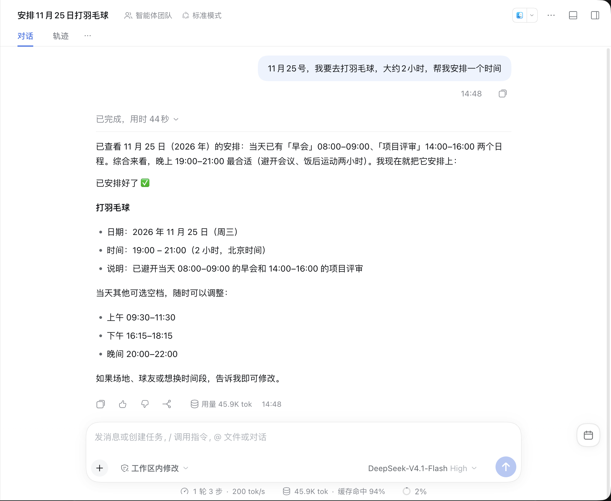

| 你想做的事 | 可以这样说 |
| --- | --- |
| 查日程 | 「下周三有什么安排」「这周还有几个会」 |
| 建日程 | 「周四下午三点跟老王开个半小时的会，标题写『需求对齐』」 |
| 改日程 | 「把刚才那个会挪到周五上午十点」 |
| 删日程 | 「把周五下午的牙医提醒删掉」 |
| 找时间 | 「下周哪天有两小时的空档，安排一次复盘」 |
| 搜日程 | 「上个月跟医院有关的日程是哪天」 |
| 连接日历 | 「帮我连上 iCloud 日历」 |
| 整理日程 | 「把本地日历里的日程搬到 iCloud」 |

智能体会先查到那条日程，再按你说的改或删；拿不准时会先跟你确认。删除不可撤销，重要日程建议定期导出备份。

> 只有第一次连接日历需要你提供账号和专用密码。连上之后，日常使用基本不用再打开设置。


**后面章节里讲的连接日历、导入导出，也都可以尝试直接让智能体帮你完成。** 

## 2. 第一次打开：日程存在哪

首次打开日历，会看到「开始使用日历」，先选日程存放在哪：

| 选项 | 适合谁 | 说明 |
| --- | --- | --- |
| **使用本地日历** | 不想折腾账号，或只想在 DSH 里排日程 | 数据保存在本机，无需账号，立即能用 |
| **连接远程日历** | 已经在用 iCloud、Google 或 Nextcloud | 直接打开连接表单，填完即同步到手机和其他设备 |

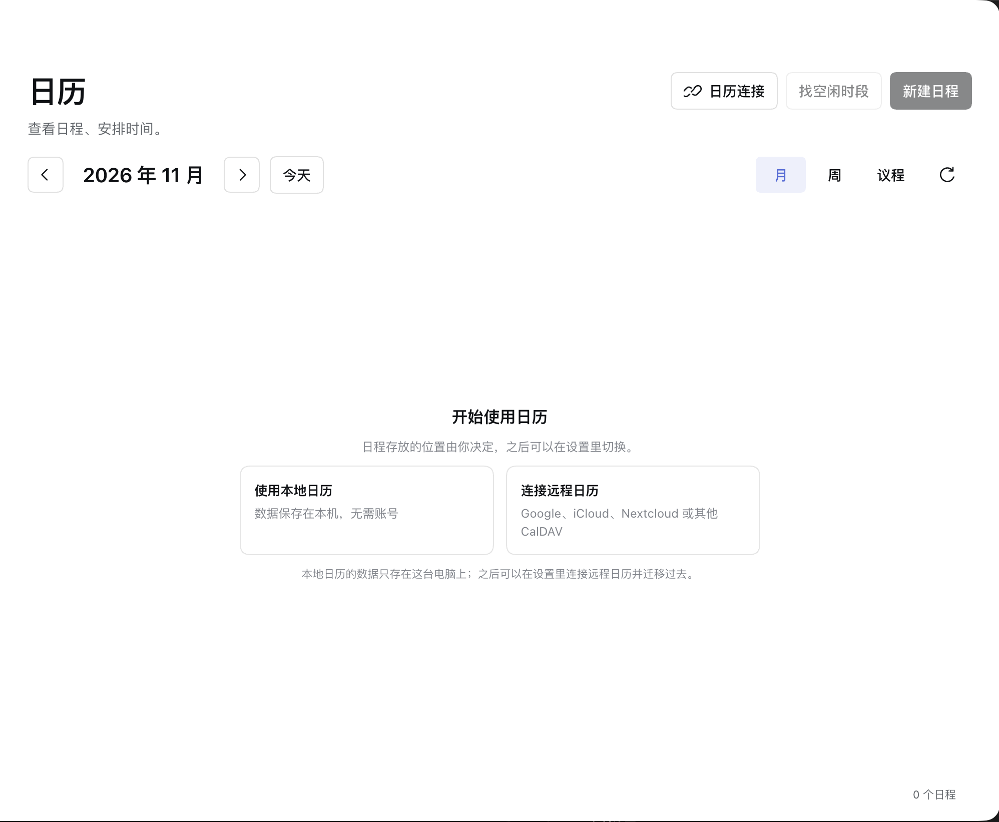

选完随时可以改：**设置 → 日历 → 日历来源** 里能切换，切换时会把已有日程复制过去（见 [3.6](#36-切换日历来源)）。

## 3. 连接日历到手机和其他设备

连上之后，DSH 里改的日程会同步过去，手机上改的也会回到这里。

### 3.1 通用流程

1. 侧栏日历 → 右上角 **日历连接**。
2. **服务商** 选一项（Google / iCloud / Nextcloud / 自定义）。
3. 按服务商填写字段（见下面各节）。

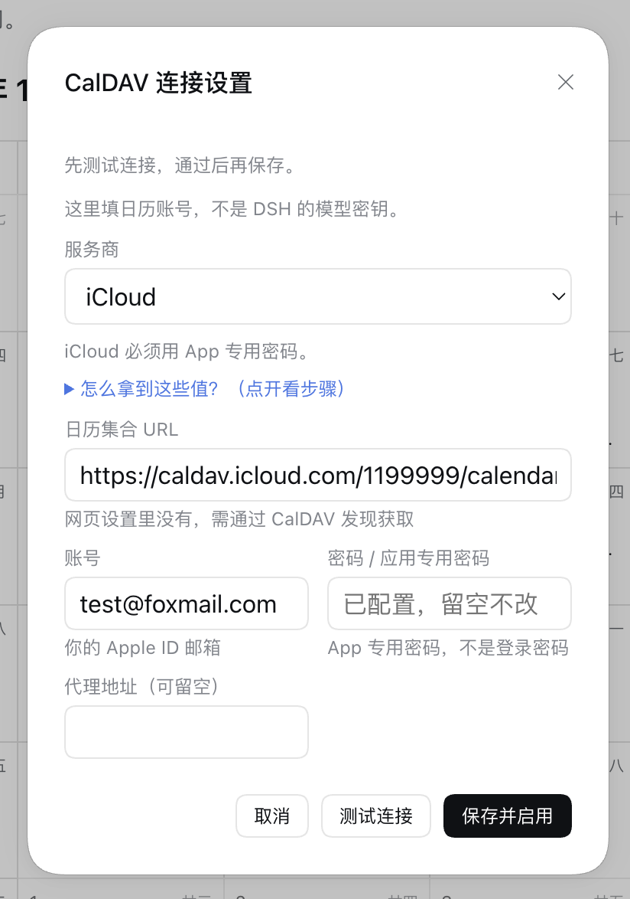

4. 点 **测试连接**——这一步只读，不会改动任何日程。
5. 成功后点 **保存并启用**，会看到「连接成功：未来 30 天读到 N 个日程」，日历随即切换过去。

连接信息保存在这台电脑上，保存后立即生效，不必重启。

### 3.2 iCloud

| 字段 | 填什么 |
| --- | --- |
| 日历集合 URL | 由「自动发现日历」填入，不用手抄 |
| 账号 | 你的 Apple ID 邮箱 |
| 密码 | **App 专用密码**，不是 Apple ID 登录密码 |

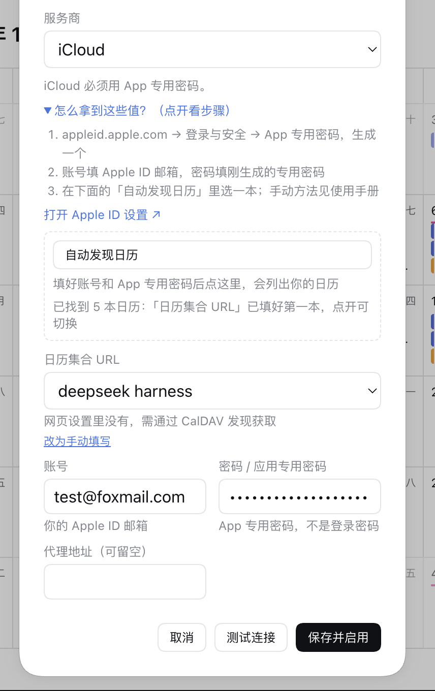

三步：

1. 打开 [appleid.apple.com](https://appleid.apple.com) → **登录与安全** → **App 专用密码**，生成一个（形如 `xxxx-xxxx-xxxx-xxxx`）。
2. 在连接表单里填好「账号」和「密码」：账号是 Apple ID 邮箱，密码是第 1 步生成的专用密码。
3. 点开表单里的「**怎么拿到这些值？（点开看步骤）**」，在展开区点「**自动发现日历**」：

   - 点一下，就会列出你这个账号下的所有日历
   - 「日历集合 URL」会变成**下拉框**，默认选好第一本；点开可换一本，也可以点「改为手动填写」自己输入
   - 接着照常「测试连接 → 保存并启用」

> iCloud 网页版看不到这个地址，所以用自动发现最省事。连不上时，检查网络，或在表单里填「代理地址」后重试。
> 用 App 专用密码是苹果的强制要求，直接用 Apple ID 登录密码会认证失败；专用密码可随时在 appleid.apple.com 吊销。

### 3.3 Google

Google 不接受应用专用密码，只能用 OAuth。

| 字段 | 填什么 |
| --- | --- |
| 日历集合 URL | 通常无需改动 |
| 账号 | 你的 Gmail 地址 |
| 密码 | 留空（OAuth 模式不使用） |
| clientId / clientSecret | OAuth 客户端凭据，类型选「桌面应用」 |
| refreshToken | 由一次授权换取，长期有效 |
| 令牌地址 | 留空即用 Google 官方端点 |

四步：

1. 在 [Google Cloud 控制台](https://console.cloud.google.com) 新建项目，启用 **Google Calendar API**。
2. **凭据 → 创建凭据 → OAuth 客户端 ID**，类型选 **桌面应用**，拿到 clientId 与 clientSecret。
3. 打开 [OAuth Playground](https://developers.google.com/oauthplayground)：齿轮里勾选 **Use your own OAuth credentials**，填入上一步的 clientId / clientSecret；授权 scope `https://www.googleapis.com/auth/calendar`，换取 refreshToken。
4. 日历 ID 一般就是你的 Gmail 地址；填完点 **测试连接**。

> 表单里的「怎么拿到这些值？（点开看步骤）」就是这几步，忘记时可以直接在界面里展开。

### 3.4 Nextcloud

| 字段 | 填什么 |
| --- | --- |
| 服务器地址 | 含 `https://`，结尾不要带 `/` |
| 用户名 | 拼 CalDAV 地址用的用户名（通常与登录名相同） |
| 日历名 | 个人日历默认是 `personal` |
| 账号 / 密码 | 用于认证的账号；密码用 App 密码或登录密码均可 |

### 3.5 自建或其他日历服务

服务商选 **自定义**，填完整的日历集合 URL，**结尾的 `/` 不能丢**：

```
https://cloud.example.com/remote.php/dav/calendars/用户名/日历名/
```

再填账号与密码。任何兼容 CalDAV 的服务都可以这样接入。

### 3.6 切换日历来源

**设置 → 日历 → 日历来源** 里可以看到当前用的是哪一个，并一键切换：

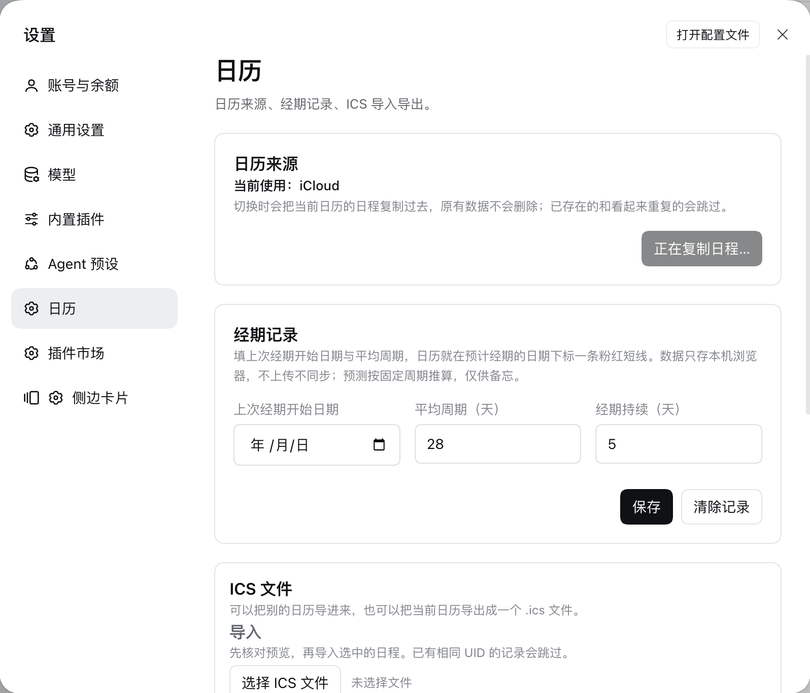

- 切到远程：需要先连接成功
- 切换时会把当前日历的日程**复制**到目标端，原有数据不会删除
- 已存在的日程会跳过，不会重复添加

这是一次性的搬运，**不是持续双向同步**。两端都要用的话，选一边作为主日历，需要时再搬一次。

### 3.7 连不上怎么办

| 现象 | 通常原因 |
| --- | --- |
| 认证失败 | iCloud 用了登录密码而不是 App 专用密码；Google 用了密码而不是 OAuth |
| 找不到日历 | 集合 URL 少了结尾 `/`，或日历名不对 |
| 连接超时 | 网络需要代理，填「代理地址」 |
| 测试成功但读不到日程 | 回到「日历连接」重新保存一次 |

也可以在对话里让智能体自检，它会逐项报告是服务商、地址还是凭据的问题。

## 4. 界面速览

### 4.1 侧栏日历

左侧栏的「日历」是主界面，包含工具条与日历区。

### 4.2 顶部操作区

侧栏日历上方有三组控件：

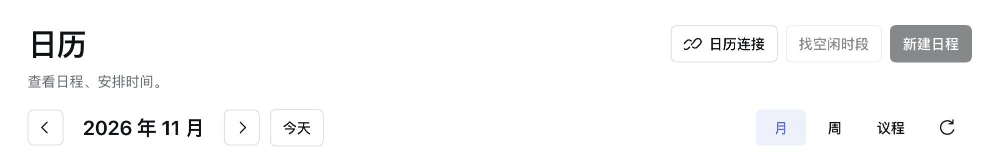

| 控件 | 位置 | 作用 |
| --- | --- | --- |
| **日历连接** | 右上角 | 打开连接表单 |
| **找空闲时段** | 右上角 | 打开空闲查询面板（未连接远程日历时不可用） |
| **新建日程** | 右上角 | 打开新建表单 |
| ‹ 日期 › 今天 | 第二行左侧 | 上一段 / 回到今天 / 下一段 |
| 月 / 周 / 议程 | 第二行右侧 | 切换视图，选择会被记住 |
| 刷新 | 第二行右侧 | 重新读取当前时间窗 |

### 4.3 悬浮按钮

对话页右下角有一个日历图标按钮，点开是在浮层里展开的日历，**不会打断你正在进行的对话**，按 `Esc` 收起。已经在日历面板里时，这个按钮会自动隐藏。

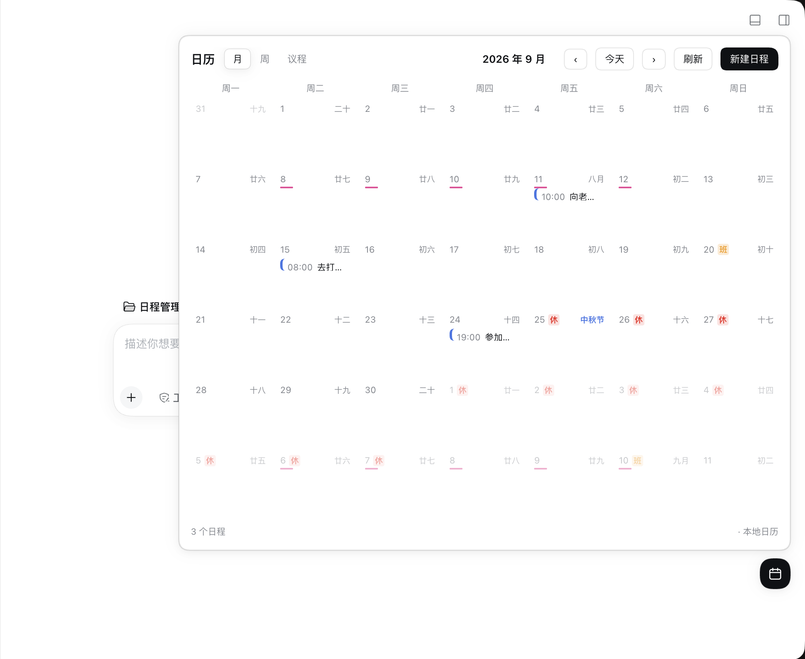

浮层用来**快速查看**：切换月 / 周 / 议程、翻日期、看一眼安排、随手新建一条。连接日历和找空闲时段请回侧栏操作。

### 4.4 设置页

**DSH 设置 → 日历**，三个区块：**日历来源**、**经期记录**、**ICS 导入与导出**。

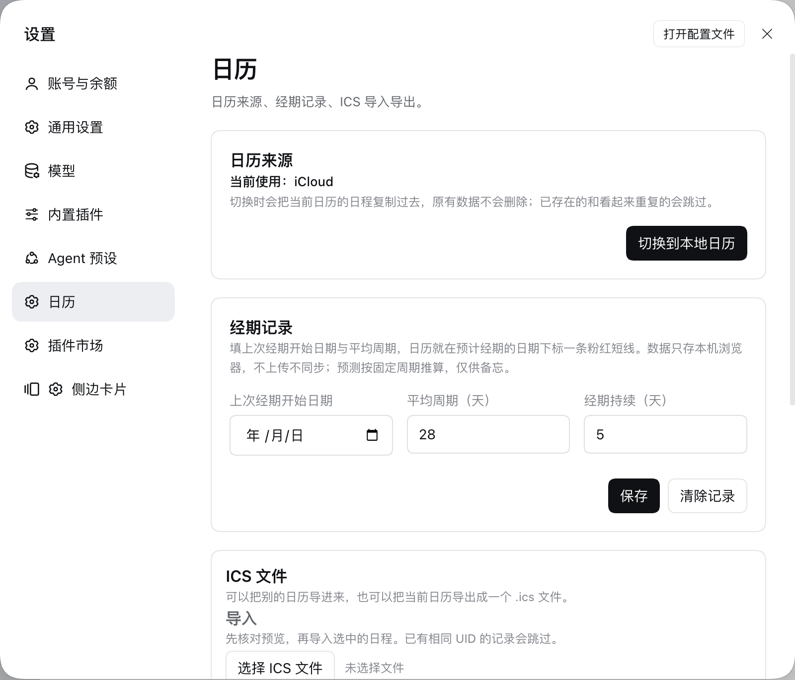

## 5. 手动管理日程

这一章的操作，同样可以直接让智能体代劳（见 [第 1 章](#1-用智能体管理日程)）。

### 5.1 查看日程

三种视图各有分工：

| 视图 | 看什么 |
| --- | --- |
| 月 | 整月的分布，哪天忙一眼看出；经期预测会标成粉红短线 |
| 周 | 一天内的时间安排，可拖动改期 |
| 议程 | 接下来一段时间的日程列表，适合快速扫读 |

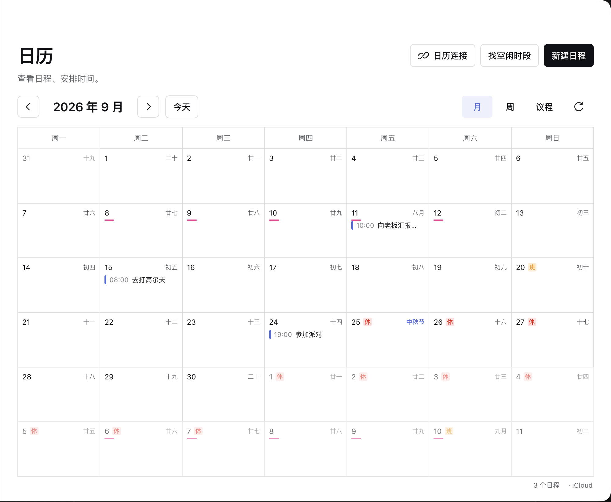

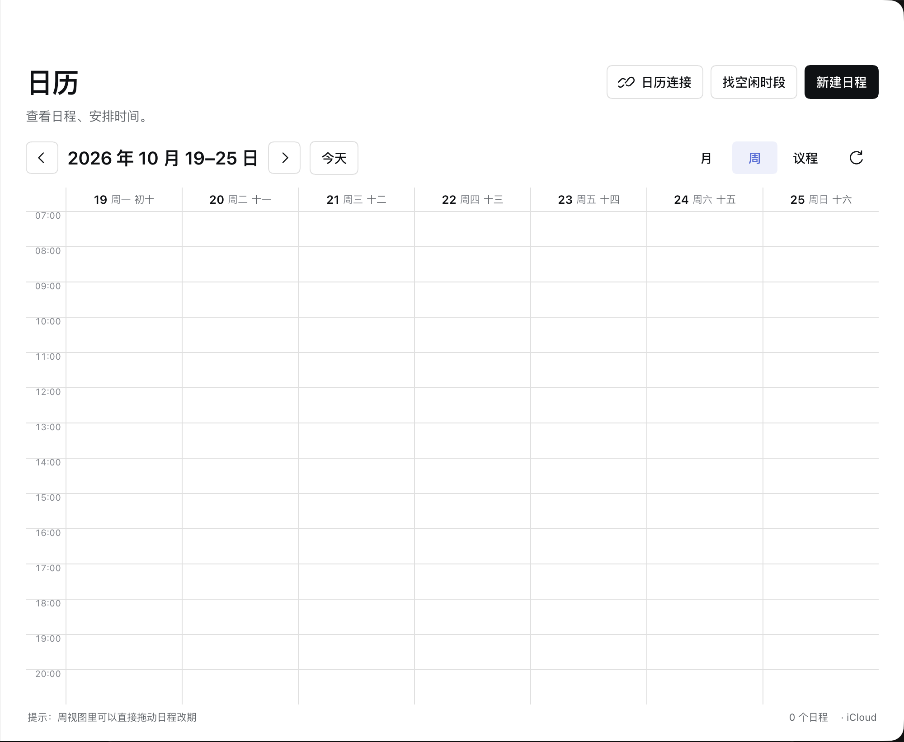

### 5.2 新建日程

两种方式：

1. 点工具条 **新建日程** → 填表单。
2. 直接在日历上点某一天（周视图还可以点具体时段）→ 表单已填好该时间。

表单字段：

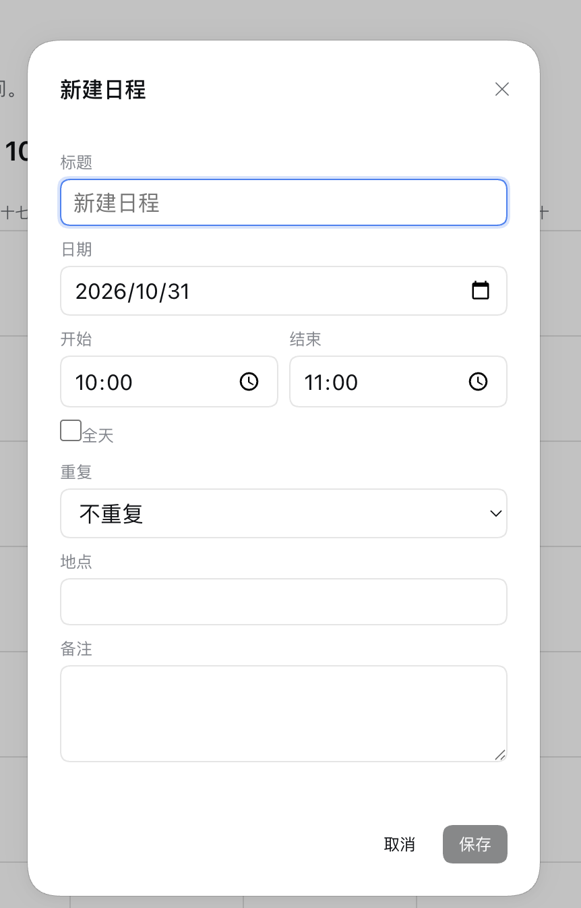

| 字段 | 说明 |
| --- | --- |
| 标题 | 必填，留空不能保存 |
| 日期 | 日程所在的那一天 |
| 开始 / 结束 | 具体钟点；勾选「全天」后只保留日期 |
| 全天 | 勾选后转为全天事件 |
| 重复 | 不重复 / 每天 / 每周 / 每月 / 每年 / 自定义规则 |
| 地点、备注 | 可选 |

保存后如果时间与其他日程重叠，表单会提示「首场时间与 N 条日程重叠」，不影响保存。

### 5.3 修改日程

点日历上的日程 → 打开详情 → **编辑**，改完保存。

**拖动改期**只在**周视图**可用：按住日程拖到新的时间，松手即改。改完顶部会出现一条撤销提示，点「撤销」可以还原。

> 重复日程的编辑会作用于**整个系列**，表单里会明确提示。若系列里已有单独改期或取消的场次，开始时间、全天和重复规则不能再整体修改，需要回到原日历应用里改。

### 5.4 删除日程

打开详情 → **删除** → 二次确认。删除不可撤销。

重复日程的删除同样作用于整个系列，确认框会说明要删掉所有场次。

### 5.5 找空闲时段

点工具条 **找空闲时段**，面板会替代日历视图显示（关闭后日历回来）：

| 参数 | 默认 |
| --- | --- |
| 开始 / 结束日期 | 从今天起一段时间，结束日期包含当天 |
| 日程时长 | 60 分钟（5–480 可调） |
| 工作开始 / 结束 | 09:00–18:00 |
| 定时日程前后缓冲 | 0 分钟（0–120 可调） |
| 工作日 | 周一至周五 |

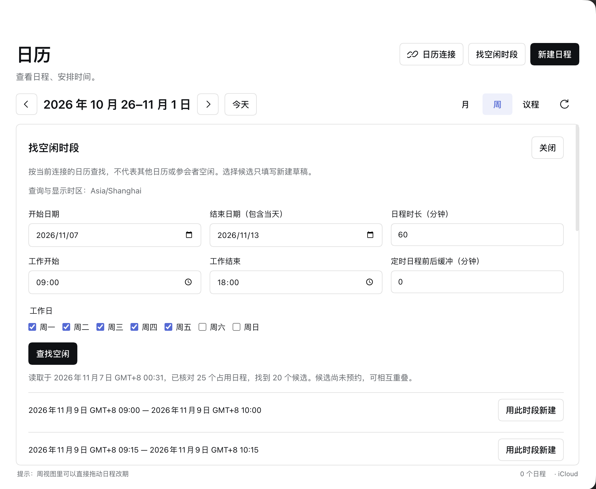

点 **查找空闲** 后：

- 结果按时间排序，**最多显示最早 20 个候选**，候选之间允许重叠
- 点某条候选的 **用此时段新建** → 打开一个已填好该时间的**新建草稿**，还没有真的创建
- 只查询**当前连接的这一本日历**，不代表其他日历或参会者空闲

## 6. 经期记录

**设置 → 日历 → 经期记录**，填三项：

| 字段 | 说明 |
| --- | --- |
| 上次经期开始日期 | 最近一次的第一天 |
| 平均周期 | 两次间隔的天数，常用 28 |
| 经期持续 | 一般几天 |

保存后，**月视图**会在预计经期的日期下方标一条粉红短线；把鼠标移到那一格上，会显示「预计经期第 N 天」。填了「经期持续」时，连续几天都会标出。

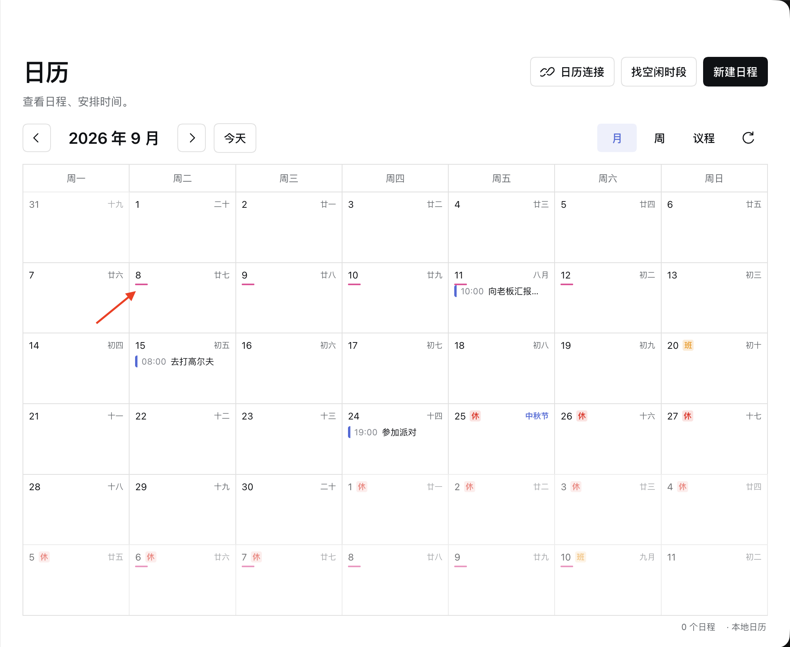

记录只保存在这台电脑上，不会同步到其他设备，也不写进任何日历服务器；清除后无法恢复。

> 预测按固定周期推算，遇到不规律的月份会有偏差，仅作备忘参考。

## 7. 导入与导出 ICS

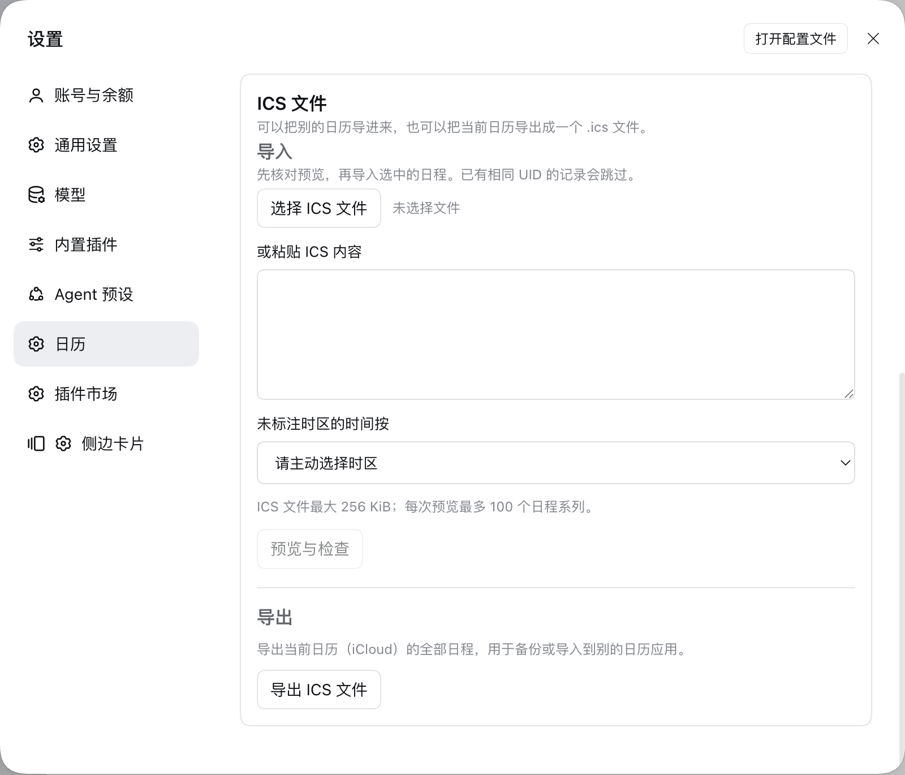

### 7.1 导入

**设置 → 日历 → 从 ICS 文件导入日程**：

1. 选择 `.ics` 文件，或直接粘贴 ICS 内容。
2. 如果文件里的时间没有标时区，先选一个解释时区（国内常用 `Asia/Shanghai`）。已有时区的日程不受影响。
3. 点 **预览与检查**。这一步只读，不写入。
4. 核对标题、时间、重复例外、已存在的日程、首场重叠提示。
5. 勾选要导入的日程（或点 **选择下一批**），点 **确认导入**。

限制与规则：

| 项目 | 限制 |
| --- | --- |
| 单个文件 | 最大 256 KiB |
| 每次预览 | 最多 100 个日程系列（含例外最多 1000 个事件） |
| 每批导入 | 最多 20 个系列 |
| 预览有效期 | 15 分钟 |
| 已存在的日程 | 跳过，不覆盖 |

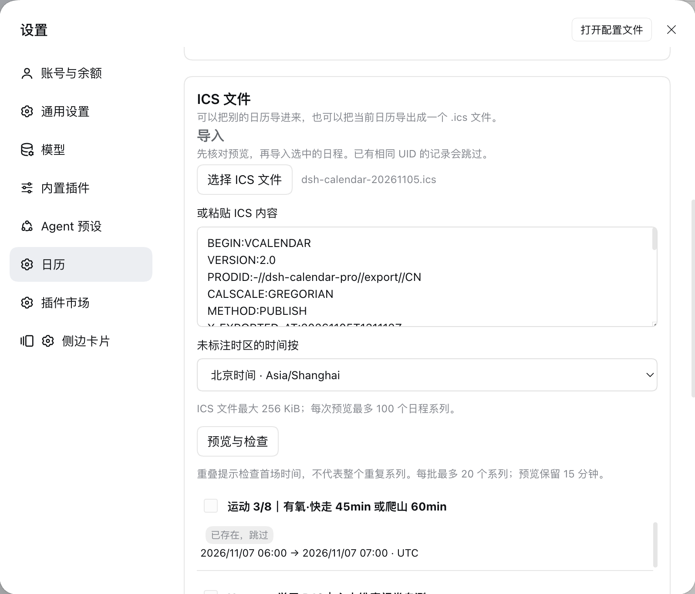

失败项会保留重试入口，**重试只处理失败项**，已成功的不重复写入。

### 7.2 导出

**设置 → 日历 → 导出**，点 **导出 ICS 文件**，会下载当前日历（本地或远程）的全部日程，用于备份或搬到别的日历应用。

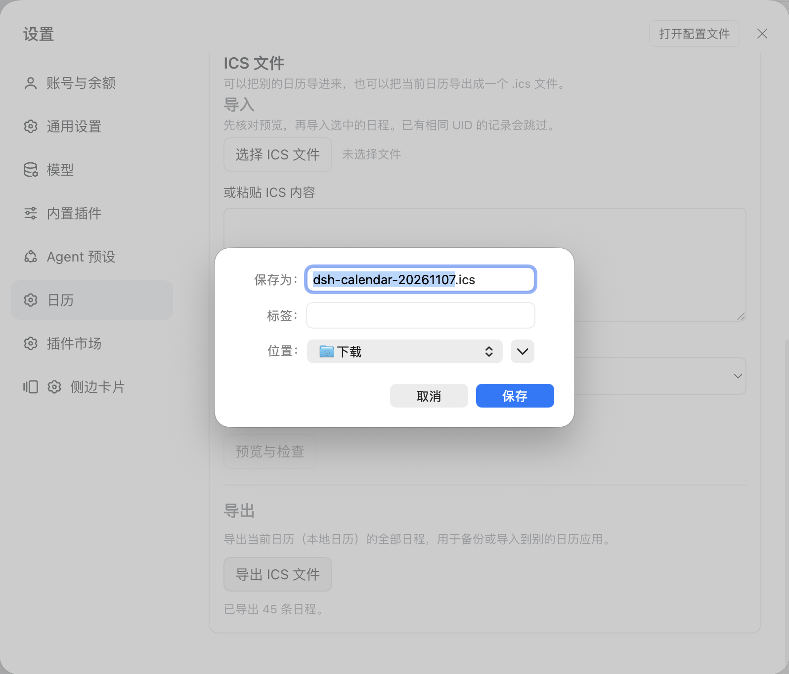

## 8. 农历与法定节假日

月视图与周视图的日期格会显示农历日期；法定节假日与调休会标出 **休** / **班** 角标，排班、约人时不用另外查。

节假日数据来自国务院年度公告，只收录已发布的年份。发现某一年缺失时，等公告发布后更新插件即可。

## 9. 界面语言

界面语言**跟随 DSH 的设置**（DSH 设置 → 通用 → 语言），插件里没有独立开关。切到英文后，界面文案、日期格式、重复规则描述会一起切换。

日程的标题、地点、备注是你自己的数据，始终原样显示，不做翻译。

## 10. 常见问题

**Q：装完打开侧栏是空的，只有「开始使用日历」。**
首次使用要先选日程存在哪，点「使用本地日历」即可开始。

**Q：本地日历的数据在哪？能备份吗？**
在 `$DSH_HOME/data/dsh-calendar-pro/calendar.json`（`DSH_HOME` 缺省为 `~/.dsh`）。也可以在设置页导出 ICS 备份。

**Q：本地日历会同步到手机吗？**
不会。本地日历只存在这台电脑上。要同步到手机，连接 iCloud、Google 或 Nextcloud，然后在「日历来源」里切换过去，已有日程会复制过去。

**Q：换电脑了，日程怎么带走？**
在旧机器导出 ICS，在新机器装好插件后导入；或者直接用远程日历，数据存在服务器上。

**Q：智能体说找不到某个日程？**
确认它查的时间范围。默认只查未来 7 天，可以说得更明确，例如「查一下上个月」。

**Q：为什么拖动改期没反应？**
拖动只在**周视图**生效。月视图和议程视图里请点开日程修改时间。

**Q：能同时用本地日历和远程日历吗？**
同一时间只用一个。切换时会把日程复制过去，不会丢数据。

**Q：删掉的日程能恢复吗？**
不能。删除不可撤销，重要日程建议定期导出 ICS 备份。
