# dsh-calendar-pro 使用手册

> **语言**：中文（本页） · [English](MANUAL.en.md)
>
> 相关文档：[README](README.md) · [变更日志](CHANGELOG.md)

日历里的事，直接跟 DSH 说一句话就行——查日程、安排会议、改时间、找空档，智能体都会帮你做好。

## 目录

- [dsh-calendar-pro 使用手册](#dsh-calendar-pro-使用手册)
  - [目录](#目录)
  - [1. 用智能体管理日程](#1-用智能体管理日程)
  - [2. 第一次打开：选择日程存放位置](#2-第一次打开选择日程存放位置)
  - [3. 界面速览](#3-界面速览)
    - [3.1 侧栏日历](#31-侧栏日历)
    - [3.2 顶部操作区](#32-顶部操作区)
    - [3.3 悬浮按钮](#33-悬浮按钮)
    - [3.4 农历与法定节假日](#34-农历与法定节假日)
    - [3.5 设置页](#35-设置页)
    - [3.6 界面语言](#36-界面语言)
  - [4. 连接远程日历](#4-连接远程日历)
    - [4.1 连接流程](#41-连接流程)
    - [4.2 iCloud](#42-icloud)
    - [4.3 Google](#43-google)
    - [4.4 Nextcloud](#44-nextcloud)
    - [4.5 自建或其他 CalDAV 服务](#45-自建或其他-caldav-服务)
    - [4.6 多本日历](#46-多本日历)
    - [4.7 切换数据源](#47-切换数据源)
    - [4.8 连接失败排查](#48-连接失败排查)
  - [5. 手动管理日程](#5-手动管理日程)
    - [5.1 查看日程](#51-查看日程)
    - [5.2 新建日程](#52-新建日程)
    - [5.3 修改日程](#53-修改日程)
    - [5.4 删除日程](#54-删除日程)
    - [5.5 找空闲时段](#55-找空闲时段)
  - [6. 经期记录](#6-经期记录)
  - [7. 导入与导出 ICS](#7-导入与导出-ics)
    - [7.1 导入](#71-导入)
    - [7.2 导出](#72-导出)
  - [8. 从邮件里收日程](#8-从邮件里收日程)
    - [8.1 连接邮箱](#81-连接邮箱)
    - [8.2 首次回扫](#82-首次回扫)
    - [8.3 待确认清单](#83-待确认清单)
    - [8.4 新邮件到达](#84-新邮件到达)
    - [8.5 识别范围](#85-识别范围)
  - [9. 常见问题](#9-常见问题)

---

## 1. 用智能体管理日程

这是最高效的用法：无需打开日历，直接用一句话描述需求。

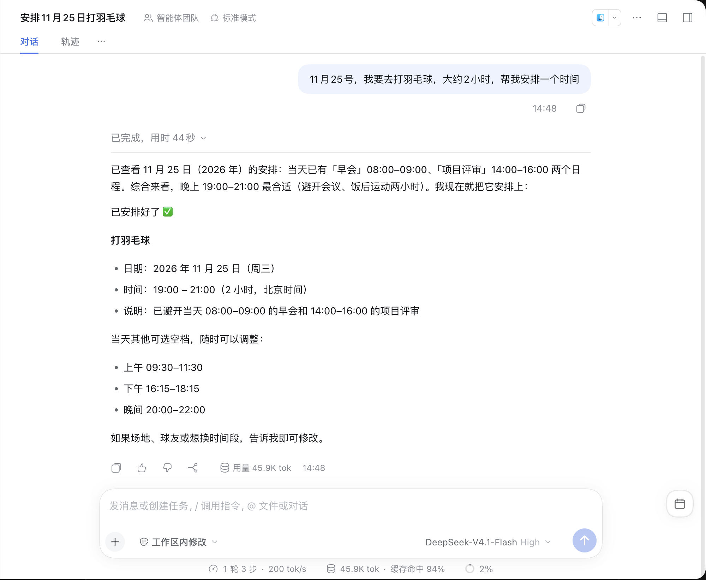

| 你想做的事 | 可以这样说 |
| --- | --- |
| 查日程 | 「下周三有什么安排」「这周还有几个会」 |
| 建日程 | 「周四下午三点跟老王开个半小时的会，标题写『需求对齐』」 |
| 改日程 | 「把刚才那个会挪到周五上午十点」 |
| 删日程 | 「把周五下午的牙医提醒删掉」 |
| 找时间 | 「下周哪天有两小时的空档，安排一次复盘」 |
| 搜日程 | 「上个月跟医院有关的日程是哪天」 |
| 连接日历 | 「帮我连上 iCloud 日历」 |
| 整理日程 | 「把本地日历里的日程转移到 iCloud」 |

智能体会先定位目标日程，再按指令修改或删除；信息不足时会先与你确认。删除不可撤销，重要日程建议定期导出备份。

> 仅首次连接日历需要提供账号与专用密码。连接完成后，日常使用无需再打开设置。

**后续章节的连接日历、导入导出，同样可交由智能体执行。**

## 2. 第一次打开：选择日程存放位置

首次打开时显示「开始使用日历」，需先选择日程的存放位置：

| 选项 | 适用场景 | 说明 |
| --- | --- | --- |
| **使用本地日历** | 无需账号，或仅在 DSH 内排日程 | 数据保存在本机，立即可用 |
| **连接远程日历** | 已在使用 iCloud、Google 或 Nextcloud | 打开连接表单（见 [第 4 章](#4-连接远程日历)），日程随账号同步至手机等其他设备 |

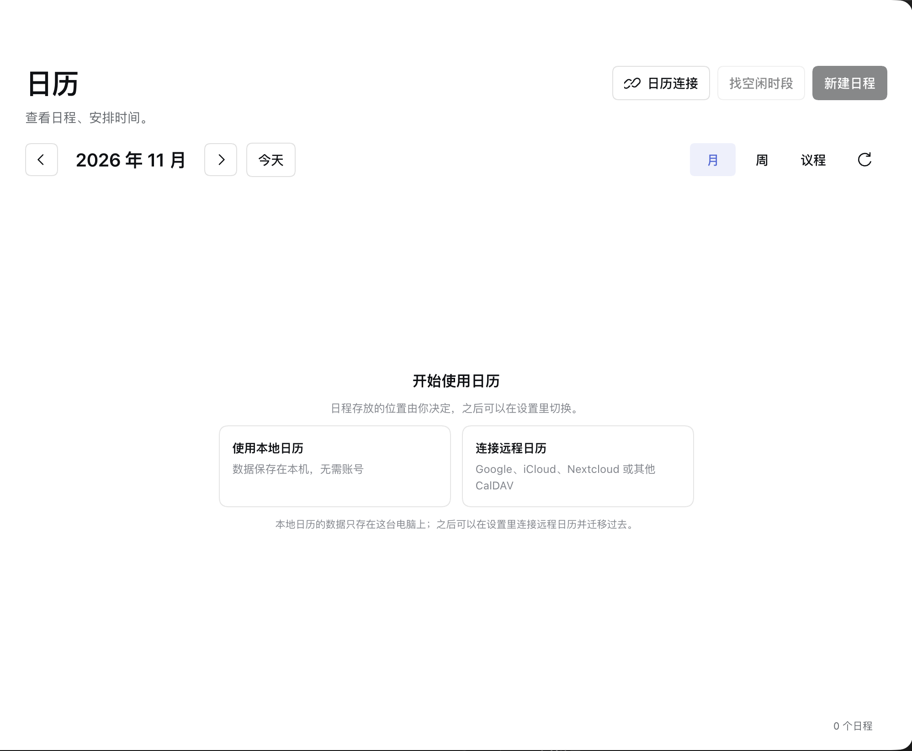

选择后可随时更改：**设置 → 日历 → 日历来源**（见 [4.7](#47-切换数据源)）。

## 3. 界面速览

### 3.1 侧栏日历

左侧栏的「日历」是主界面，由顶部操作区与日历区组成。

### 3.2 顶部操作区

页头右上角有四个动作按钮：


| 按钮 | 作用 | 详见 |
| --- | --- | --- |
| **邮件日程** | 打开待确认清单；有待办时按钮上显示条数 | [第 8 章](#8-从邮件里收日程) |
| **日历连接** | 打开连接表单 | [第 4 章](#4-连接远程日历) |
| **找空闲时段** | 弹窗查询空闲时段，日历保留在后层作为参照（未连接远程日历时不可用） | [5.5](#55-找空闲时段) |
| **新建日程** | 打开新建表单 | [5.2](#52-新建日程) |

日历区上方另有一排视图控件：

| 控件 | 位置 | 作用 |
| --- | --- | --- |
| ‹ 日期 › 今天 | 左侧 | 上一段 / 回到今天 / 下一段 |
| 月 / 周 / 议程 | 右侧 | 切换视图，选择会被记住 |
| 刷新 | 右侧 | 重新读取当前时间窗 |

### 3.3 悬浮按钮

对话页右下角有一个日历图标按钮，点击后以浮层展开日历，**不打断当前对话**，按 `Esc` 收起。已在日历面板中时，该按钮自动隐藏。

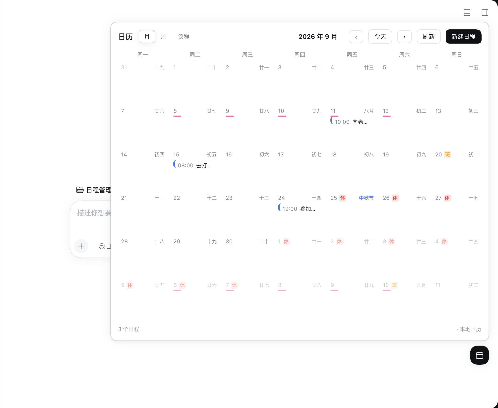

浮层仅包含翻页、月 / 周 / 议程、刷新与**新建日程**；邮件日程、日历连接、找空闲时段仅在侧栏提供，避免同一功能出现两处入口。

### 3.4 农历与法定节假日

月视图与周视图的日期格显示农历日期；法定节假日与调休以 **休** / **班** 角标标注，排班、约人时无需另行查询。

节假日数据来自国务院年度公告，仅收录已发布的年份。若某一年缺失，待公告发布后更新插件即可。

### 3.5 设置页

**DSH 设置 → 日历** 包含四个区块：

| 区块 | 用途 | 详见 |
| --- | --- | --- |
| **日历来源** | 查看当前数据源，在本地与远程之间切换 | [4.7](#47-切换数据源) |
| **邮件日程识别** | 连接只读邮箱，从邮件中提取日程候选 | [第 8 章](#8-从邮件里收日程) |
| **经期记录** | 记录经期，在月视图中标注预测 | [第 6 章](#6-经期记录) |
| **ICS 导入与导出** | 导入、导出 `.ics` 文件 | [第 7 章](#7-导入与导出-ics) |

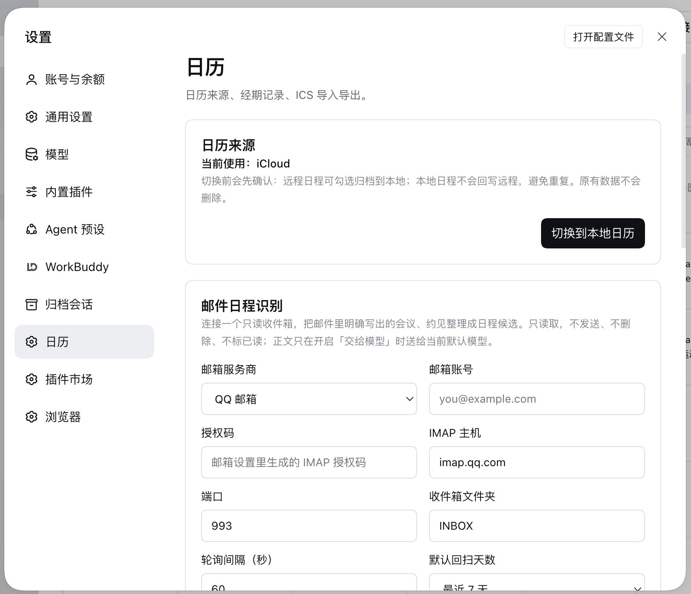

### 3.6 界面语言

界面语言**跟随 DSH 设置**（DSH 设置 → 通用 → 语言），插件不提供独立开关。切换至英文后，界面文案、日期格式与重复规则描述一并切换。

日程的标题、地点、备注属于你的个人数据，始终原样显示，不做翻译。

## 4. 连接远程日历

连接后，DSH 与日历服务器保持同步：在 DSH 中修改的日程写入服务器，手机等其他设备通过同一账号获取最新数据。

### 4.1 连接流程

所有服务商的连接步骤一致，差异仅在凭据类型与是否支持自动发现：

1. **打开表单**：侧栏日历 → 右上角 **日历连接**。
2. **选择服务商**：默认为 iCloud；使用 Google、Nextcloud 或自建 CalDAV 时手动切换。切换后表单字段随之变化，服务商下方常驻该服务商的取值步骤与外链。
3. **填写凭据**：各服务商所需字段见 [4.2](#42-icloud)–[4.5](#45-自建或其他-caldav-服务)。网络需要代理时，填写「代理地址」。
4. **选择日历**：iCloud 在凭据填写后自动列出账号下的日历，在「日历集合 URL」字段内勾选（见 [4.2](#42-icloud)）；其他服务需手动填写日历集合 URL。
5. **测试连接**：只读校验，不改动任何日程。
6. **保存并启用**：显示「连接成功：未来 30 天读到 N 个日程」，数据源随即切换为该远程日历。

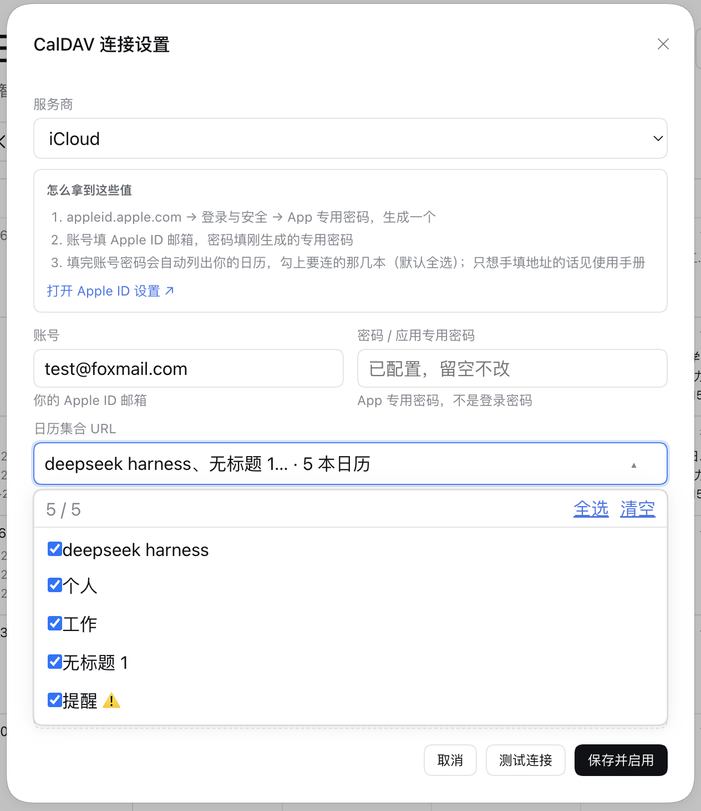

连接信息仅保存在本机，保存后立即生效，无需重启。

### 4.2 iCloud

iCloud 须使用 App 专用密码，并支持自动发现账号下的日历。

| 字段 | 填写内容 |
| --- | --- |
| 账号 | Apple ID 邮箱地址 |
| 密码 | **App 专用密码**，非 Apple ID 登录密码 |
| 日历集合 URL | 自动发现后变为日历多选，无需手动填写 |
| 代理地址 | 可选；无法直连时填写 |

步骤：

1. **生成 App 专用密码**：打开 [appleid.apple.com](https://appleid.apple.com) → **登录与安全** → **App 专用密码**，生成一个专用密码（形如 `xxxx-xxxx-xxxx-xxxx`）。
2. **填写账号与密码**：账号为 Apple ID 邮箱，密码为上一步生成的专用密码。
3. **选择日历**：账号或密码字段失焦后，自动列出该账号下的日历；打开表单时若账号已填且密码已保存，也会直接列出。结果在「日历集合 URL」字段内选择：
   - 收起时以单行显示已选日历名称与数量，点击展开清单；默认全选，上限 16 本
   - 清单仅显示**日历名**，顶部提供「全选 / 清空」
   - 未勾选任何日历时提示「至少勾选一本日历」，「测试连接」与「保存并启用」同时禁用
   - 需手动输入地址时，点击「改为手动填写」
4. **测试并保存**：点击「测试连接」，通过后点击「保存并启用」。

> iCloud 网页版不显示日历集合 URL，自动发现是获取地址的推荐方式。若发现失败，请检查网络，或填写「代理地址」后重试。
> App 专用密码由 Apple 强制要求，使用 Apple ID 登录密码将导致认证失败；专用密码可随时在 appleid.apple.com 吊销。

### 4.3 Google

Google 不接受应用专用密码，只能使用 OAuth。

| 字段 | 填写内容 |
| --- | --- |
| 日历 ID | 通常为 Gmail 地址 |
| clientId / clientSecret | OAuth 客户端凭据，类型选「桌面应用」 |
| refreshToken | 由一次授权换取，长期有效 |
| 令牌地址 | 留空即用 Google 官方端点 |
| 代理地址 | 可选；无法直连时填写 |

步骤：

1. 在 [Google Cloud 控制台](https://console.cloud.google.com) 新建项目，启用 **Google Calendar API**。
2. **凭据 → 创建凭据 → OAuth 客户端 ID**，类型选 **桌面应用**，获取 clientId 与 clientSecret。
3. 打开 [OAuth Playground](https://developers.google.com/oauthplayground)：在齿轮菜单中勾选 **Use your own OAuth credentials**，填入上一步的 clientId / clientSecret；授权 scope `https://www.googleapis.com/auth/calendar`，换取 refreshToken。
4. 填写完毕后点击 **测试连接**，通过后点击 **保存并启用**。

> 表单中的「怎么拿到这些值？」即上述步骤，常驻于服务商下方，可随时查阅。

### 4.4 Nextcloud

| 字段 | 填写内容 |
| --- | --- |
| 服务器地址 | 包含 `https://`，结尾不带 `/` |
| 用户名 | 用于拼接 CalDAV 地址的用户名（通常与登录名相同） |
| 日历名 | 个人日历默认名称为 `personal` |
| 账号 / 密码 | 认证账号；密码可使用 App 密码或登录密码 |

### 4.5 自建或其他 CalDAV 服务

服务商选 **自建 CalDAV**，填写完整的日历集合 URL，**结尾的 `/` 不可省略**：

```
https://cloud.example.com/remote.php/dav/calendars/用户名/日历名/
```

再填写账号与密码（需要时填写「代理地址」）。兼容 CalDAV 的服务均可按此方式接入。

### 4.6 多本日历

iCloud 账号下通常有多本日历（如「家庭」「工作」「生日」）。连接时勾选多本后，它们合并为一个视图显示，无需在多本之间切换；勾选方法见 [4.2](#42-icloud) 第 3 步，上限 16 本。Google、Nextcloud 与自定义服务每次按一个日历集合 URL 连接一本。

合并后的行为：

- **查看**：日历视图显示所有已勾选日历的日程合并结果。同一日程在两本中重复出现（共享日历、重复收到邀请）时只显示一次
- **来源标识**：勾选不止一本时，日程详情与列表中标明所属日历；仅勾选一本时不显示该项
- **查询**：向智能体提问「这周有什么安排」时，同时查询所有已勾选的日历；也可指定「只看工作那本」
- **约时间**：查找空闲时段时，任一已勾选日历上有安排的时间均被排除，不会给出冲突时段
- **写入**：新建表单包含「日历」一行，默认第一本，可改为任意一本；智能体也可按名称指定。指定后，修改与删除仅作用于该本日历中的日程
- **单本异常隔离**：某一本读取失败（网络、权限、服务器端已删除）时，其余日历照常显示，并在结果中注明读取失败的那一本

修改勾选：**侧栏日历 → 日历连接**，使账号或密码字段失焦（未修改字段时，打开表单也会自动重新列出），调整勾选后保存。仅保留一本时，行为与单本连接完全一致。

> 一个连接对应一个账号与一份凭据。同一账号下的多本日历可合并；两个不同账号（如公司账号与个人账号）需分别连接，暂不支持同时查看。

### 4.7 切换数据源

**设置 → 日历 → 日历来源** 显示当前使用的数据源（区块位置见 [3.5](#35-设置页)），点击「切换到…」后先弹出确认框。两个方向的确认内容不同。

**远程 → 本地（归档）**

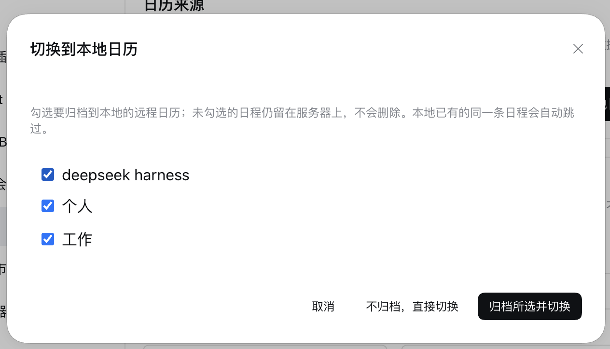

- 勾选需归档到本地的远程日历，默认全选；勾选后点击 **归档所选并切换**。也可选「不归档，直接切换」，远程日程保留在服务器上，不做删除
- 本地已存在的同一日程（同 UID）自动跳过，不重复写入
- 归档的日程保留来源日历名，后续编辑该日程时标签仍保留

**本地 → 远程**

弹窗仅提供 **确认切换** 按钮：

- 确认后仅切换数据源；本地日程**不会回写**远程，以免与远程已有日程重复
- 本地文件仍保留在本机，切回后依然可用

**首次连接远程**为独立路径：在「日历连接」中保存成功时，本地已有日程会被推送至远程第一本；再次保存同一连接不会重复推送。

以上操作均为一次性转移，**不是持续双向同步**。如需两端同时使用，请选定一侧为主日历，需要时再次转移。

### 4.8 连接失败排查

| 现象 | 通常原因 |
| --- | --- |
| 认证失败 | iCloud 使用登录密码而非 App 专用密码；Google 使用密码而非 OAuth |
| 找不到日历 | 集合 URL 缺少结尾 `/`，或日历名不正确 |
| 连接超时 | 网络需要代理，需填写「代理地址」 |
| 测试成功但读不到日程 | 返回「日历连接」重新保存一次 |

也可在对话中让智能体自检，逐项判断问题出在服务商、地址还是凭据。

## 5. 手动管理日程

本章操作同样可交由智能体执行（见 [第 1 章](#1-用智能体管理日程)）。

### 5.1 查看日程

三种视图的分工：

| 视图 | 用途 |
| --- | --- |
| 月 | 整月分布，忙碌程度一目了然；经期预测以粉红短线标注 |
| 周 | 单日时间安排，支持拖动改期 |
| 议程 | 后续一段时间的日程列表，适合快速浏览 |

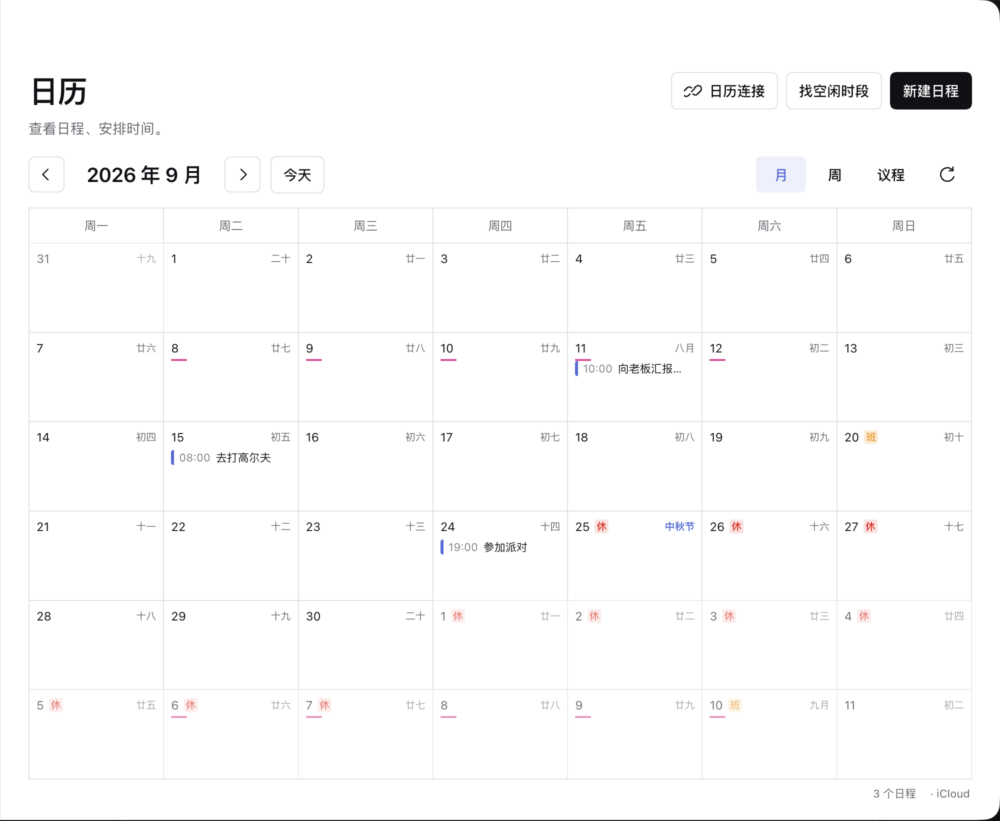

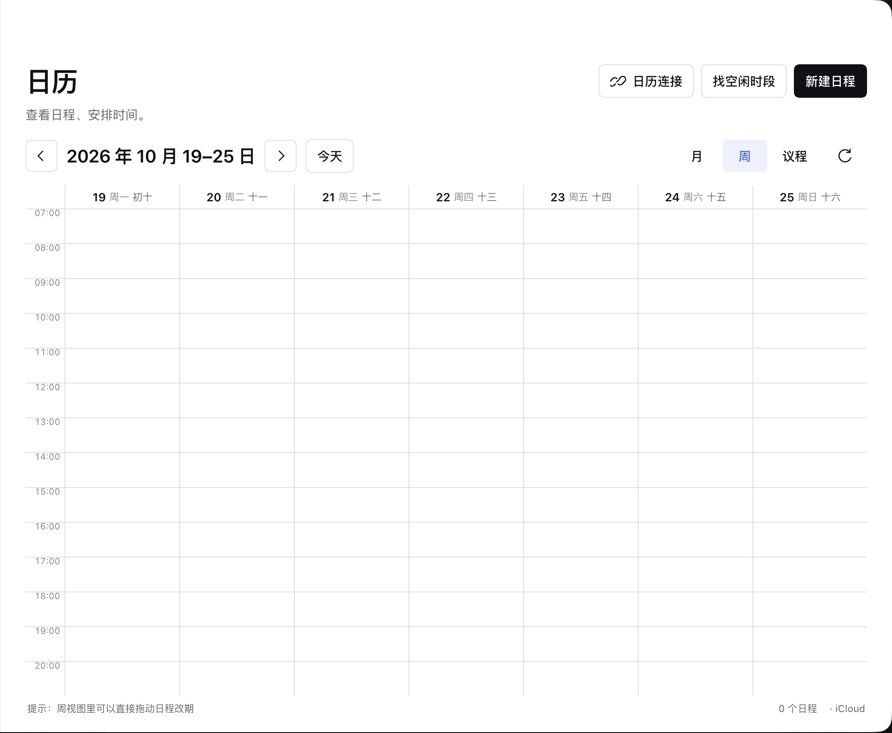

### 5.2 新建日程

两种方式：

1. 点击工具条 **新建日程** → 填写表单。
2. 直接在日历上点击某一天（周视图还可点击具体时段）→ 表单已预填该时间。

表单字段：

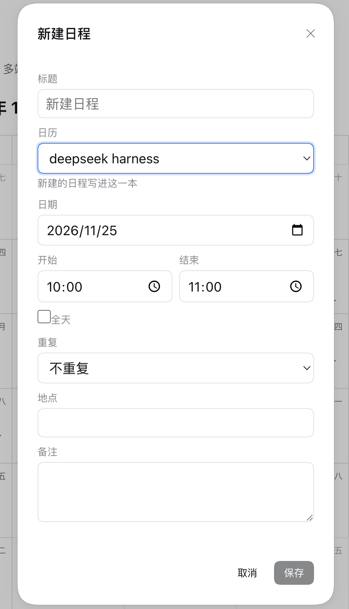

| 字段 | 说明 |
| --- | --- |
| 标题 | 必填，留空无法保存 |
| 日历 | 仅在连接多本日历（同一账号）时出现：选择该日程写入哪一本，默认第一本 |
| 日期 | 日程所在日期 |
| 开始 / 结束 | 具体时间；勾选「全天」后仅保留日期 |
| 全天 | 勾选后转为全天事件 |
| 重复 | 不重复 / 每天 / 每周 / 每月 / 每年 / 自定义规则 |
| 地点、备注 | 可选 |

保存时若时间与其他日程重叠，表单会提示「首场时间与 N 条日程重叠」，不影响保存。

### 5.3 修改日程

点击日历上的日程 → 打开详情 → **编辑**，修改后保存。

**拖动改期**仅在**周视图**可用：按住日程拖至新的时间，松开即生效。完成后顶部出现撤销提示，点击「撤销」可还原。

> 重复日程的编辑作用于**整个系列**，表单中会明确提示。若系列中已有单独改期或取消的场次，开始时间、全天与重复规则无法整体修改，需回到原日历应用中修改。

### 5.4 删除日程

打开详情 → **删除** → 二次确认。删除不可撤销。

重复日程的删除同样作用于整个系列，确认框会说明将删除所有场次。

### 5.5 找空闲时段

点击页头 **找空闲时段**，弹出查询窗口，日历保留在后层显示（关闭窗口后恢复原状）：

| 参数 | 默认 |
| --- | --- |
| 开始 / 结束日期 | 从今天起一段时间，结束日期包含当天 |
| 日程时长 | 60 分钟（5–480 可调） |
| 工作开始 / 结束 | 09:00–18:00 |
| 定时日程前后缓冲 | 0 分钟（0–120 可调） |
| 工作日 | 周一至周五 |

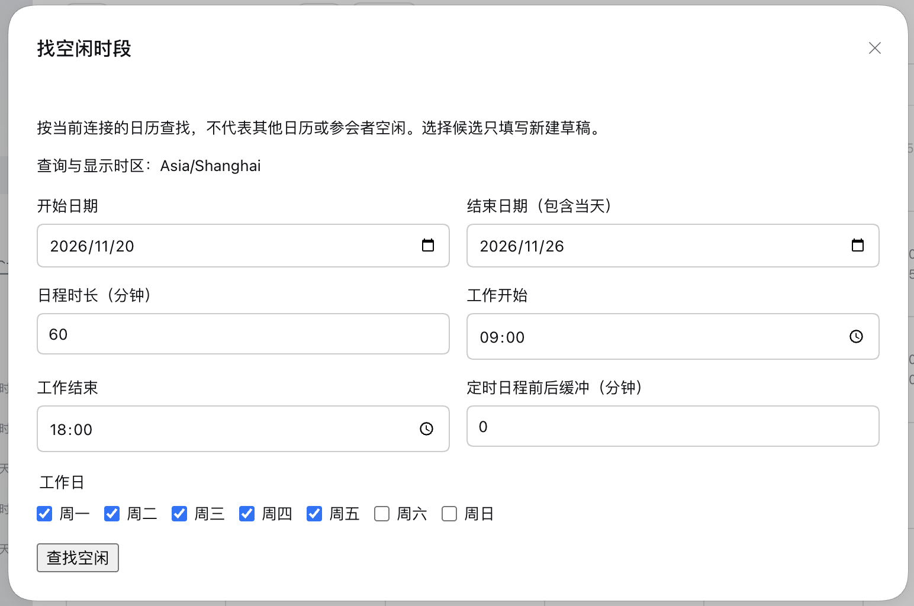

窗口顶部标注「查询与显示时区」，跟随系统时区，无需手动修改。

点击 **查找空闲** 后：

- 结果按时间排序，**最多显示最早 20 个候选**，候选之间允许重叠
- 点击某条候选的 **用此时段新建** → 打开已预填该时间的新建草稿，此时尚未创建
- 查询范围为**当前连接的全部日历**：按已勾选日历的并集计算，任一已勾选日历上有安排的时间均不进入候选；未勾选的日历不计入
- 结果仅代表本人日历，**不代表参会者的空闲**

窗口宽约 760px，条件区固定在上方，候选列表独立滚动；窄屏下条件区改为单列，窗口接近全屏。

## 6. 经期记录

**设置 → 日历 → 经期记录**，填写三项：

| 字段 | 说明 |
| --- | --- |
| 上次经期开始日期 | 最近一次经期的第一天 |
| 平均周期 | 两次开始日期之间的天数，常用值 28 |
| 经期持续 | 持续天数 |

保存后，**月视图**在预计经期的日期下方标注粉红短线；鼠标悬停该日期格时显示「预计经期第 N 天」。填写「经期持续」时，连续数日一并标注。

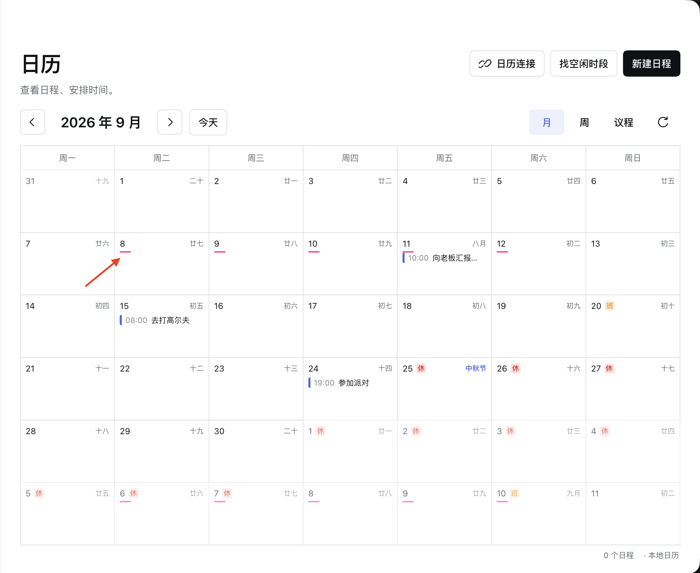

记录仅保存在本机，不同步至其他设备，也不写入任何日历服务器；清除后无法恢复。

> 预测按固定周期推算，周期不规律的月份会存在偏差，仅供备忘参考。

## 7. 导入与导出 ICS

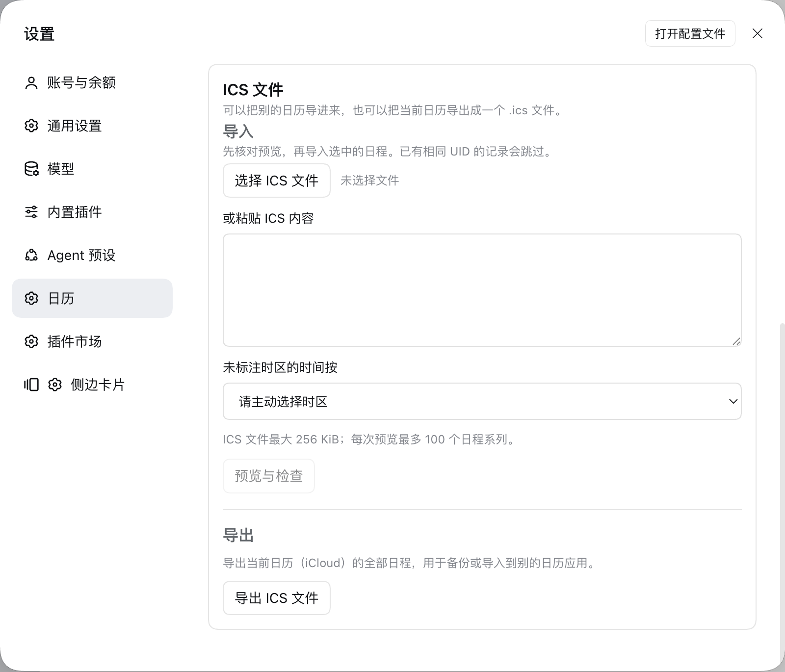

### 7.1 导入

**设置 → 日历 → 从 ICS 文件导入日程**：

1. 选择 `.ics` 文件，或直接粘贴 ICS 内容。
2. 若文件内时间未标注时区，先选择一个解释时区（国内常用 `Asia/Shanghai`）。已带时区的日程不受影响。
3. 点击 **预览与检查**。该步骤只读，不写入数据。
4. 核对标题、时间、重复例外、已存在的日程与首场重叠提示。
5. 勾选需导入的日程（或点击 **选择下一批**），点击 **确认导入**。

限制与规则：

| 项目 | 限制 |
| --- | --- |
| 单个文件 | 最大 256 KiB |
| 每次预览 | 最多 100 个日程系列（含例外最多 1000 个事件） |
| 每批导入 | 最多 20 个系列 |
| 预览有效期 | 15 分钟 |
| 已存在的日程 | 跳过，不覆盖 |

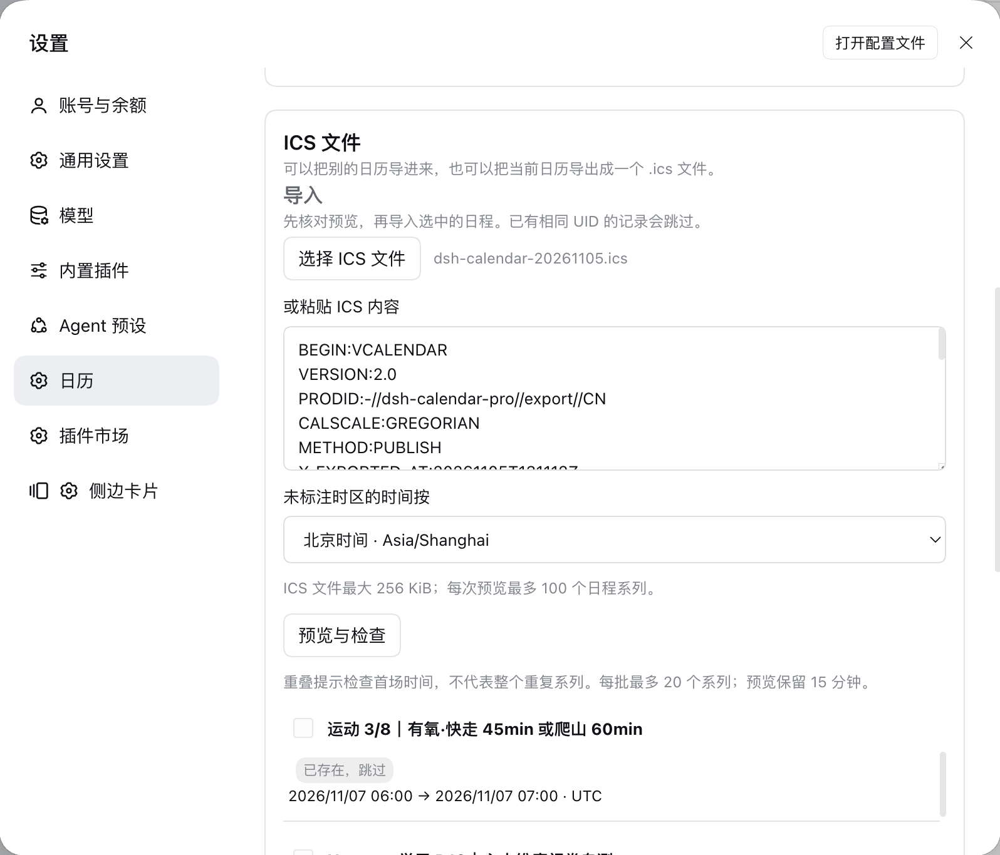

失败项保留重试入口，**重试仅处理失败项**，已成功的日程不会重复写入。

### 7.2 导出

**设置 → 日历 → 导出**，点击 **导出 ICS 文件**，将下载当前日历（本地或远程）的全部日程，用于备份或迁移至其他日历应用。

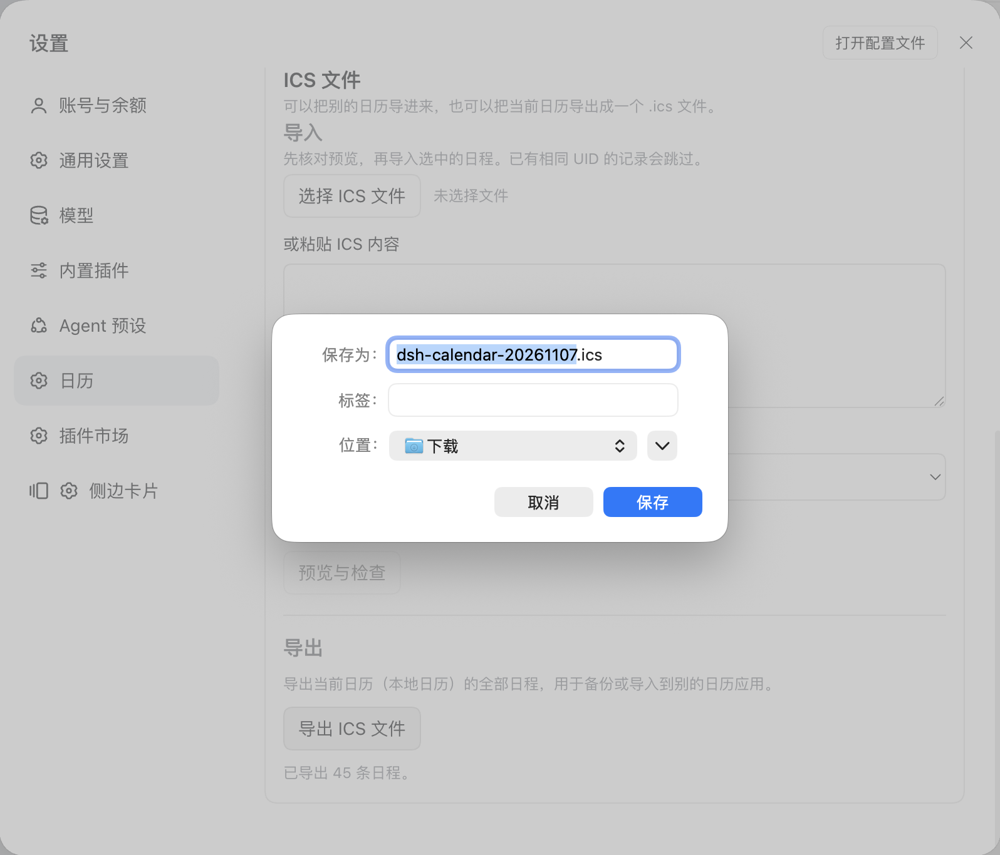

## 8. 从邮件里收日程

邮件中写明「周三下午三点开会」这类安排时，无需再手动录入日历。插件可连接一个**只读**收件箱，将邮件中明确写出的时间整理为**日程候选**，经确认后才写入日历。

### 8.1 连接邮箱

打开 **DSH 设置 → 日历 → 邮件日程识别**：

1. **邮箱服务商**：选择 QQ 邮箱、163、Gmail、Outlook、iCloud，或「自定义 IMAP」。切换服务商时主机与端口自动填写。
2. **邮箱账号**：完整邮箱地址。
3. **授权码**：非登录密码，而是邮箱设置中生成的 **IMAP 授权码**（QQ 邮箱需在「设置 → 账号 → POP3/IMAP/SMTP 服务」中开启后获取）。
4. 其余项通常无需修改：收件箱文件夹默认 `INBOX`，SSL 默认开启，端口 993。
5. 点击 **测试连接**，显示「连接成功」后点击 **保存**。

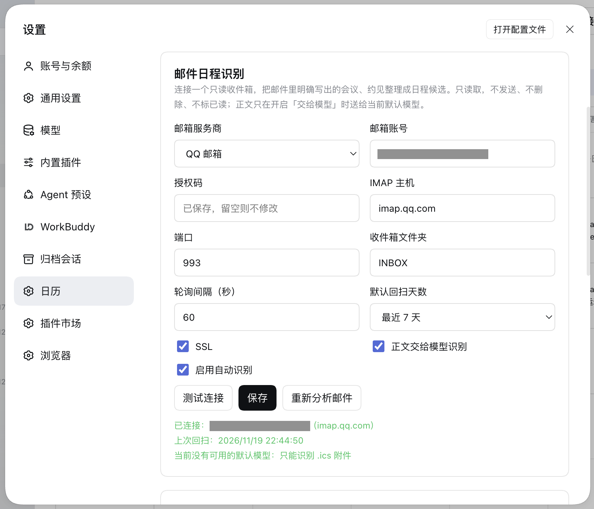

保存成功后，卡片底部显示三行状态：已连接的账号与主机、上次回扫时间、识别能力提示。若当前无可用默认模型，将显示「当前没有可用的默认模型：只能识别 .ics 附件」，此时不读取正文。首次回扫完成后，卡片上会新增 **重新分析邮件** 按钮。

**功能边界**：连接邮箱、按需读取邮件、将识别结果保存在本机。不发送、不删除、不标记已读、不移动邮件。授权码保存在 `$DSH_HOME/data/dsh-calendar-pro/mail.json`，仅存于本机。

### 8.2 首次回扫

首次保存成功后会弹出窗口，询问**是否分析最近的邮件**。可选 1 / 3 / 7 / 30 天，默认 7 天。跳过亦可，之后可在设置页点击「重新分析邮件」补充扫描。

分析在后台逐封进行，关闭窗口不会中断。已处理的邮件会被记录，重扫不会重复生成候选。

### 8.3 待确认清单

识别出的日程不会直接写入日历，而是先进入**待确认清单**。两个入口：

- 侧栏日历右上角的 **「邮件日程」** 按钮（有待办时显示条数）
- 悬浮按钮上方轻提示中的 **「查看待办」**

设置页首次回扫结束后会直接展示结果，无需再次点击按钮。

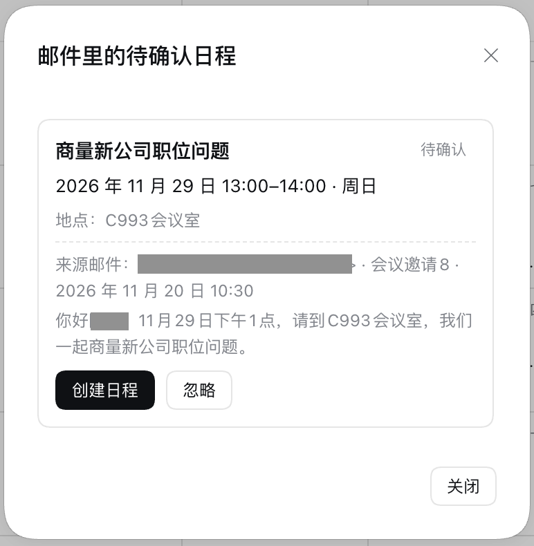

窗口标题为「邮件里的待确认日程」。每条候选为一张卡片：标题、状态（待确认 / 待重试）、时间（含星期）、地点、来源邮件（发件人 · 主题 · 收到时间）与正文摘要，卡片右下角提供两个按钮：

| 按钮 | 效果 |
| --- | --- |
| **创建日程** | 打开已预填的新建表单（标题、时间、地点、备注均取自来源邮件），核对或修改后保存 |
| **忽略** | 仅针对该条：从清单中移除，同封邮件中的其他候选不受影响 |

**为什么需要二次确认**：识别由模型读取正文完成，时间与标题可能存在偏差。先展示已填好的表单，较直接写入后再撤回更稳妥。

### 8.4 新邮件到达

插件按设置中的**轮询间隔**（默认 60 秒）检查新邮件。识别到日程时：

- 右下角悬浮按钮出现红色角标，数字为未查看的新候选数量
- 按钮上方弹出轻提示：「识别到 N 个日程」与「来自刚收到的邮件，需要你确认后才会写进日历」，提供 **查看待办** 与 **稍后** 两个按钮；点击「查看待办」**仅打开待确认清单**，不展开日历

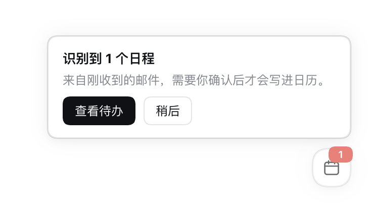

打开清单后角标清零，未处理的候选仍保留在清单中。清单无候选时仅显示一行「没有待确认的日程」；未连接邮箱时提示配置位置。

### 8.5 识别范围

**识别**：邮件中写明具体日期与时间的安排，例如「12 月 1 日上午 10 点，3 楼会议室，Q4 评审」「明天下午 5 点，请到 C992 会议室」。日期可写作「11 月 21 日」「本周四」或「明天」，但须与具体时间同时出现。带 `.ics` 邀请附件的邮件按附件解析，较读取正文更准确。

**不识别**：无具体时间的任务，例如「尽快把材料发我」「下周找个时间对齐」——不进入清单，也不生成待办。单封邮件最多提取 5 条日程，避免群发邮件产生过量候选。

**可关闭**：在设置页关闭「启用自动识别」即停止轮询；关闭「正文交给模型识别」后仅识别 `.ics` 附件，邮件正文不会发送给模型。

## 9. 常见问题

**Q：安装后打开侧栏为空，仅有「开始使用日历」。**
首次使用需先选择日程存放位置，点击「使用本地日历」即可开始。

**Q：本地日历的数据在哪？能否备份？**
位于 `$DSH_HOME/data/dsh-calendar-pro/calendar.json`（`DSH_HOME` 缺省为 `~/.dsh`）。也可在设置页导出 ICS 备份。

**Q：本地日历会同步到手机吗？**
不会。本地日历仅存于本机。如需同步至手机，请连接 iCloud、Google 或 Nextcloud：首次连接保存时，本地日程推送至远程第一本；此后在「日历来源」中切换不会将本地日程回写远程。

**Q：更换电脑后如何迁移日程？**
在旧机器导出 ICS，在新机器的插件中导入；或直接使用远程日历，数据保存在服务器上。

**Q：智能体找不到某个日程？**
确认查询时间范围。默认仅查询未来 7 天，可明确指定范围，例如「查一下上个月」。

**Q：拖动改期无响应？**
拖动仅在**周视图**生效。月视图与议程视图请打开日程修改时间。

**Q：能否同时使用本地日历与远程日历？**
同一时间仅使用一个数据源。远程日程可勾选归档到本地，本地文件保留在本机；切换不会删除两端数据。

**Q：删除的日程能否恢复？**
不能。删除不可撤销，重要日程建议定期导出 ICS 备份。
